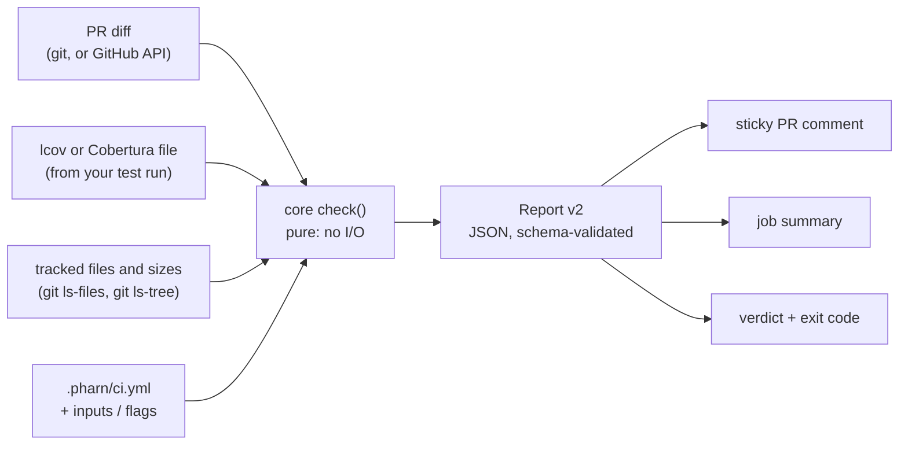

<div align="center">


# pharn-ci

**Know whether AI coding agents can safely work in your repo.**

A GitHub Action and CLI that checks every pull request for the two things an agent-written change
leans on most: tests that actually run the new code, and the setup files that tell agents how to
behave. AI-agnostic, fully stateless, no telemetry.

```yaml
- uses: pharn-dev/pharn-ci@v0.3.0
  with:
    coverage-file: coverage/lcov.info
    threshold: 80
```

[](https://github.com/pharn-dev/pharn-ci/actions/workflows/ci.yml)
[](https://github.com/pharn-dev/pharn-ci/actions/workflows/codeql.yml)
[](https://github.com/pharn-dev/pharn-ci/actions/workflows/gitleaks.yml)
[](./LICENSE)
[](./package.json)
[](https://pharn.dev)

</div>

> **Status:** pre-1.0; the latest release is `v0.3.0` ([changelog](CHANGELOG.md)). Pin the tag's
> full commit SHA for integrity. The report schema is stable within a version (v2 from 0.2.0). Before 1.0, inputs, outputs and message
> codes are never removed, and a renamed input keeps working under its old name, with a warning, for
> at least one minor release; defaults change only in a minor release and the changelog says so. The
> comment layout may change in any release ([versioning policy](docs/RELEASING.md#inputs-outputs-and-message-codes)).

---

## Contents

- [What pharn-ci is](#what-pharn-ci-is)
- [Why it exists](#why-it-exists)
- [Quick start](#quick-start)
- [How it works](#how-it-works)
- [Example PR comment](#example-pr-comment)
- [Test integrity](#test-integrity)
- [Secrets in agent configs](#secrets-in-agent-configs)
- [Org policy](#org-policy)
- [Upload to pharn.dev (optional)](#upload-to-pharndev-optional)
- [Action reference](#action-reference)
- [CLI](#cli)
- [Config](#config)
- [Report v2](#report-v2)
- [Agent skills](#agent-skills)
- [What it proves, and what it does not](#what-it-proves-and-what-it-does-not)
- [Safety model](#safety-model)
- [The Pharn family](#the-pharn-family)
- [Roadmap](#roadmap)
- [Development](#development)
- [Contributing and security](#contributing-and-security)
- [License](#license)

---

## What pharn-ci is

pharn-ci runs in your CI on every pull request and reports:

- **Diff coverage**: the share of lines **added** in the PR that your tests execute, with an
  optional threshold gate. It reads the lcov or Cobertura XML file your own test run already writes
  (Clover and JaCoCo native XML are not supported).
- **Agent setup inventory**: which agent setup files the repo carries (`CLAUDE.md`, `AGENTS.md`,
  `GEMINI.md`, `.claude/` files, MCP configs, and the files of Cursor, Copilot, Codex, Windsurf,
  Cline, Aider, Continue, Roo Code, Amazon Q Developer, Junie, Zed, Augment, Kiro, Goose, OpenCode
  and Gemini CLI; see the table below), with a summary of how many there are and which tools they
  configure.

| Kind                          | Matches                                                                                        | Tools                                             |
| ----------------------------- | ---------------------------------------------------------------------------------------------- | ------------------------------------------------- |
| `claude-md`                   | `CLAUDE.md`, any directory                                                                     | claude-code                                       |
| `claude-local-md`             | `CLAUDE.local.md`, any directory                                                               | claude-code                                       |
| `agents-md`                   | `AGENTS.md`, any directory                                                                     | amp, codex, copilot, cursor, jules, opencode, zed |
| `gemini-md`                   | `GEMINI.md`, any directory                                                                     | gemini                                            |
| `claude-settings`             | `.claude/settings.json`, repo root                                                             | claude-code                                       |
| `claude-settings-local`       | `.claude/settings.local.json`, repo root                                                       | claude-code                                       |
| `claude-skill`                | files under `.claude/skills/`, any directory                                                   | claude-code                                       |
| `claude-hook`                 | files under `.claude/hooks/`, any directory                                                    | claude-code                                       |
| `claude-agent`                | files under `.claude/agents/`, any directory                                                   | claude-code                                       |
| `claude-command`              | files under `.claude/commands/`, any directory                                                 | claude-code                                       |
| `claude-rule`                 | files under `.claude/rules/`, any directory                                                    | claude-code                                       |
| `cursor-rules`                | files under `.cursor/rules/` (any directory), `.cursorrules`                                   | cursor                                            |
| `cursor-mcp`                  | `.cursor/mcp.json`, repo root                                                                  | cursor, mcp                                       |
| `copilot-instructions`        | `.github/copilot-instructions.md`                                                              | copilot                                           |
| `copilot-instructions-scoped` | `.github/instructions/**/*.instructions.md`                                                    | copilot                                           |
| `copilot-agents`              | files under `.github/agents/`                                                                  | copilot                                           |
| `copilot-prompts`             | files under `.github/prompts/`                                                                 | copilot                                           |
| `vscode-mcp`                  | `.vscode/mcp.json`, repo root                                                                  | copilot, mcp                                      |
| `codex-config`                | `.codex/config.toml`, repo root                                                                | codex                                             |
| `windsurf-rules`              | `.windsurfrules`, files under `.windsurf/rules/`                                               | windsurf                                          |
| `cline-rules`                 | `.clinerules` (file or directory)                                                              | cline                                             |
| `mcp-config`                  | `.mcp.json`, repo root                                                                         | mcp                                               |
| `aider-config`                | `.aider.conf.yml`, repo root                                                                   | aider                                             |
| `conventions-md`              | `CONVENTIONS.md`, repo root                                                                    | aider                                             |
| `continue-rules`              | files under `.continue/rules/`, `.continuerules`, repo root                                    | continue                                          |
| `roo-rules`                   | `.roorules`, `.roorules-<mode>`, files under `.roo/rules/` and `.roo/rules-<mode>/`, repo root | roo                                               |
| `amazonq-rules`               | files under `.amazonq/rules/`, repo root                                                       | amazon-q                                          |
| `junie-guidelines`            | `.junie/guidelines.md`, repo root                                                              | junie                                             |
| `zed-rules`                   | `.rules`, repo root                                                                            | zed                                               |
| `augment-rules`               | files under `.augment/rules/`, `.augment-guidelines`, repo root                                | augment                                           |
| `kiro-steering`               | files under `.kiro/steering/`, repo root                                                       | kiro                                              |
| `goosehints`                  | `.goosehints`, any directory                                                                   | goose                                             |
| `opencode-config`             | `opencode.json`, `opencode.jsonc`, repo root                                                   | opencode                                          |
| `gemini-settings`             | `.gemini/settings.json`, repo root                                                             | gemini                                            |

Placeholders do not count: a dot-file (such as `.gitkeep`) or a README under a directory in the table
is not listed, and neither is any path with a `node_modules` directory. A listed file that is empty in
`HEAD` gets an `AGENT_SETUP_FILE_EMPTY` warning, and stays in the inventory.

It is **AI-agnostic**: it looks at your code, tests and setup files, never at which tool wrote the
code. Claude Code, Cursor, Copilot, Codex and hand-written changes are measured the same way.

The output is one sticky PR comment, the job summary, a pass/warn/fail verdict, and a JSON report
with a published schema that agents and scripts can read.

---

## Why it exists

Agents write diffs faster than people can review them. Review time does not scale with them, so
the cheap, mechanical questions should be answered before a person opens the PR:

- Did the tests run the code this change added, or only the code that was already there?
- Does the repo tell agents how to work in it at all, and where?
- Can a script or another agent read the answer without parsing prose?

pharn-ci answers those on every PR, with numbers and stable message codes rather than judgment. It
is a floor, not a verdict on quality: it says what was measured and, just as plainly, what was not
([What it proves](#what-it-proves-and-what-it-does-not)).

---

## Quick start

Working with Claude Code? The `pharn-ci-install` skill can do this setup for you; see
[Agent skills](#agent-skills).

Add a workflow that runs your tests with lcov or Cobertura XML output, then pharn-ci. With vitest,
`@vitest/coverage-v8` must be a dev dependency of the project (`npm install --save-dev
@vitest/coverage-v8`); without it `vitest run --coverage` aborts and writes no report:

```yaml
# .github/workflows/pharn-ci.yml
name: pharn-ci
on: pull_request

permissions:
  contents: read
  pull-requests: write
  id-token: write # lets pharn-ci fetch your org policy (see Org policy); leave it out to run without one

# One run per PR at a time, so concurrent pushes do not race on the sticky comment. The github.ref
# fallback gives each merge-queue entry its own group, since merge_group events have no PR number.
concurrency:
  group: pharn-ci-${{ github.event.pull_request.number || github.ref }}
  cancel-in-progress: true

jobs:
  pharn-ci:
    runs-on: ubuntu-latest
    steps:
      - uses: actions/checkout@3d3c42e5aac5ba805825da76410c181273ba90b1 # v7.0.1
        with:
          fetch-depth: 0
      # ...set up your toolchain and run tests with lcov or Cobertura output, e.g.:
      - run: npx vitest run --coverage --coverage.reporter=lcov
      - uses: pharn-dev/pharn-ci@v0.3.0 # or, better, the tag's full commit SHA
        timeout-minutes: 5
        with:
          coverage-file: coverage/lcov.info
          threshold: 80
```

`fetch-depth: 0` lets pharn-ci diff against the PR base locally. Without a threshold, pharn-ci
reports and never fails the step. With a merge queue, add `merge_group` to `on:`; pharn-ci diffs
the queued change against the queue's base (`merge_group.base_sha`). The `concurrency` group
cancels an older run when a new commit is pushed; without it, two runs that each post the sticky
comment are cleaned up to one, but the older run may write last. Keep the `|| github.ref`
fallback: a `merge_group` event has no PR number, so without it every queue entry shares one group
and cancels the others' required check.

Each GitHub API request pharn-ci makes is aborted after 30 s, and a 5xx, a network error or a rate
limit that asks for at most 60 s is retried once; each `git` call is killed after 2 minutes. A run
makes a handful of requests, so `timeout-minutes: 5` on the step bounds even a slow GitHub without
cutting a normal run short; without it, a stuck step runs until the job's 6-hour limit.

Release tags are exact versions (`v0.1.0`), never moved or deleted, but they are unsigned
lightweight tags, so there is no tag signature to verify. Pinning the tag's full commit SHA is the
integrity control; Dependabot keeps either up to date.

`coverage-file` may be left out. With no `coverage-file` input and no `coverage.file` in the
config, pharn-ci auto-discovers the report at one of five paths, relative to the repo root:
`coverage/lcov.info`, `lcov.info`, `coverage.xml`, `coverage/cobertura-coverage.xml` and
`**/coverage.cobertura.xml` (anywhere in the repo outside `.git` and `node_modules`; several
matches are read and merged). If reports are found at more than one of those paths, pharn-ci
refuses to guess and fails with an error asking you to set the path; if none is found, the report
carries a `COVERAGE_FILE_MISSING` message. Each file it reads is logged as `coverage: <path>
(auto-discovered)`. A complete workflow for each of vitest, jest, pytest, .NET and cargo, with no
`coverage-file` set, is in [`examples/workflows/`](examples/workflows/).

### Coverage per ecosystem

Point `coverage-file` at what your test run writes. Each of these tools produces a format pharn-ci
reads (`coverage-format: auto` detects lcov or Cobertura XML per file):

| Ecosystem       | Produce the report                                                         | `coverage-file`                                  |
| --------------- | -------------------------------------------------------------------------- | ------------------------------------------------ |
| vitest          | `npx vitest run --coverage --coverage.reporter=lcov` (needs `@vitest/coverage-v8`) | `coverage/lcov.info`                     |
| jest            | `npx jest --coverage --coverageReporters=lcov`                             | `coverage/lcov.info`                             |
| pytest-cov      | `pytest --cov --cov-report=xml` (Cobertura XML)                            | `coverage.xml`                                   |
| coverlet (.NET) | `dotnet test --collect:"XPlat Code Coverage"` (Cobertura XML)              | `TestResults/**/coverage.cobertura.xml`          |
| cargo-llvm-cov  | `cargo llvm-cov --lcov --output-path lcov.info`                            | `lcov.info`                                      |
| Go              | `go test -coverprofile=cover.out ./...`, then `gcov2lcov -infile cover.out -outfile lcov.info` | `lcov.info`                  |
| JaCoCo / Kover  | Convert the JaCoCo or Kover XML to Cobertura XML with a converter; the native XML is not read | the converted file                |

`coverage-file` takes one entry per line, each a path or a glob, relative to the workspace. All the
files are merged, and a line's hits are summed across them. A monorepo with a report per package:

```yaml
# the `with:` of the pharn-ci step
with:
  coverage-file: |
    packages/*/coverage/lcov.info
    tools/cli/coverage.xml
  threshold: 80
```

`coverage-root` applies to every file. If each package's report writes paths relative to that
package (`SF:src/index.ts`), have the test runner write absolute paths or paths from the repository
root instead; otherwise those paths match no tracked file and pharn-ci reports
`COVERAGE_PATHS_UNMATCHED` or `COVERAGE_PATHS_PARTIALLY_UNMATCHED`.

---

## How it works



| Step     | What happens                                                                                                                                 |
| -------- | -------------------------------------------------------------------------------------------------------------------------------------------- |
| Gather   | The Action or CLI reads the coverage file, the diff against the base, the tracked file list and the config. All I/O happens here.          |
| Measure  | `packages/core` matches added lines against the lines the coverage report knows, and classifies agent setup files. Pure functions only.     |
| Report   | Core builds a Report v2 object. Every report produced in tests is validated against `schema/report.v2.json`.                                |
| Render   | The comment, job summary and CLI text are renderings of that report, never a separate source of truth.                                     |

---

## Example PR comment

> 
>
> ## 🛡️ pharn-ci · ❌ Fail
>
> > [!CAUTION]
> > **Fail** · Diff coverage of this change is 71.43% against a threshold of 80%; 8 agent setup files found.
>
> | Verdict | Diff coverage | Test integrity | Agent setup |
> | --- | --- | --- | --- |
> | ❌ Fail | 71.43% (threshold 80%) | none (warn) | 8 files |
>
> ### 🧪 Diff coverage
>
> **71.43%** of changed lines covered (5/7, threshold 80%)
>
> <details open>
> <summary>Changed files (3)</summary>
>
> | File | Coverage | Covered | Uncovered lines |
> | --- | ---: | ---: | --- |
> | `src/new.ts` | 50% | 1/2 | 5 |
> | `src/math.ts` | 75% | 3/4 | 10 |
> | `src/utils/new-name.ts` | 100% | 1/1 |  |
>
> </details>
>
> ### 🔍 Test integrity
>
> No test-integrity findings (mode: warn).
>
> ### 💬 Messages (2)
>
> - ❌ `DIFF_COVERAGE_BELOW_THRESHOLD` Diff coverage 71.43% is below the threshold of 80%.
>   - Hint: Add tests that exercise the uncovered lines listed in the table above.
> - ℹ️ `COVERAGE_PATHS_PARTIALLY_UNMATCHED` 1 file path in the coverage report is not a tracked file in the repository; its coverage is not used.
>   - Hint: Nothing to do if those files are generated or outside the repo; if changed files are missing from the table, check the coverage root.
>
> ### 🤖 Agent setup (8 files)
>
> Agent setup: 8 files · amp, claude-code, codex, copilot, cursor, jules, mcp, opencode, zed
>
> <details>
> <summary>Agent setup files (8)</summary>
>
> | Path | Kind |
> | --- | --- |
> | `.claude/settings.json` | claude-settings |
> | `.claude/skills/release/SKILL.md` | claude-skill |
> | `.cursor/rules/style.mdc` | cursor-rules |
> | `.github/copilot-instructions.md` | copilot-instructions |
> | `.mcp.json` | mcp-config |
> | `AGENTS.md` | agents-md |
> | `CLAUDE.md` | claude-md |
> | `packages/web/CLAUDE.md` | claude-md |
>
> </details>
>
> ---
>
> <sub>pharn-ci 0.3.0 · report schema v2 · coverage format lcov</sub>

On PRs from forks the token cannot comment; pharn-ci then warns and uses the job summary only.

Each workflow and job keeps its own comment, marked by a hidden `<!-- pharn-ci scope: <workflow>/<job> -->`
line. Matrix legs of one job share that scope, and so one comment.

---

## Test integrity

Diff coverage says which added lines a test ran. Test integrity looks at the other side of the change: did it make the
tests weaker? The `test-integrity` input takes `block`, `warn` or `off`, and the default is `warn`.

- `block`: a block-level finding fails the check.
- `warn`: a block-level finding warns and does not fail the check.
- `off`: nothing is checked.

`test_integrity.mode` in `.pharn/ci.yml` can only make the mode stricter, never looser, so a pull request cannot loosen
its own gate by editing the config. The signals so far are TI01, TI02, TI03, TI04, TI05, TI06, TI07, TI08, TI09, TI10,
TI11, TI12, TI13, TI14, TI15 and TI16:

| Signal | What it reports | Severity in mode `block` | JS/TS | Python |
| --- | --- | --- | --- | --- |
| TI01 | a test file deleted | block; `info` when the change also deletes the code it tested, or its tests are found again by body | yes | yes |
| TI02 | a test removed from a test file that stays | block; `warn` for a computed name | yes | yes |
| TI03 | a skip added to a test | block for an unconditional skip of an existing test; `warn` otherwise | yes | yes |
| TI04 | a `.only`, `fit` or `fdescribe` added | block | yes | not applicable |
| TI05 | a test emptied of its assertions, or with fewer | block when none are left; `warn` for fewer | yes | yes |
| TI06 | a test weakened: a weaker matcher, a lower assertion guard, an assertion that compares a literal with itself, or an assertion moved into a `try`/`catch` or after an early `return` | `warn` | yes | yes |
| TI07 | an expected value of a test edited to match, in a change that also edits source | `warn` | yes | yes |
| TI08 | snapshots regenerated or updated in bulk | `warn` | yes | yes (pytest config) |
| TI09 | a test-runner setting loosened | block; `warn` for a raised retry count or timeout, or a value that is not a literal | yes | yes |
| TI10 | a test script in `package.json` weakened | block | yes | no |
| TI11 | CI stopped running tests | block for a removed test command or `pull_request` trigger; `warn` otherwise | yes | yes |
| TI12 | a module under test mocked: a new `vi.mock`, `jest.mock` or Python `patch` of a source file the change also edits | `warn` | yes | yes |
| TI13 | a coverage-ignore comment added to source | block | yes | yes |
| TI14 | a lower coverage threshold or a wider exclusion in the pharn-ci config | block | yes | not applicable |
| TI15 | a source condition that compares with a value the tests add | `info` | yes | yes |
| TI16 | a lint or type suppression comment added to a test file | `info` | yes | yes |

In mode `warn` every `block` above is a `warn`. TI06, TI07, TI08 and TI12 warn and TI15 and TI16 give an `info` finding
in both `block` and `warn`, so those six never fail the check. Each reads the diff, and TI02, TI05, TI06, TI07 and TI12
also read the text of the JS/TS and Python test files the change modifies at the merge base and at HEAD, parsed without
running them: a test counts as removed only when no test of the same name or a similar body is left in the touched test
files (a test of the same name in another touched file counts only when it holds the removed test's body), and
`TEST_INTEGRITY_INDEX_UNAVAILABLE` names a file that could not be compared. TI09 reads the text of the touched
test-runner config files the same way (`vitest.config.*`, `vite.config.*`, `vitest.workspace.*`, `jest.config.*`,
`playwright.config.*`, `.mocharc.*`, `package.json`, `pytest.ini`, `tox.ini`, `setup.cfg` and `pyproject.toml`) and
compares a fixed list of settings between the two: a lowered coverage threshold, a narrower test list (`include`,
`testMatch`, `testpaths`, `spec`), a wider exclusion (build directories, `node_modules` and `.d.ts` files excepted),
`passWithNoTests`, `allowOnly` or `bail` turned on, a `grep` added, `forbidOnly` turned off, or a pytest `addopts` that
gains `-k`, `-m`, `--deselect`, `--ignore` or `-x`. A raised retry count or timeout is a warning only, and so is a value
that is not a literal and cannot be compared. When a change adds, removes, modifies or renames tests, the comment also
holds a collapsed "Tests changed" table with the counts per test file; the test names are in `report.json` only. A
reviewer who is not the author can sign off block findings with the accept label: see [Accept label](#accept-label).

Python test files are parsed with the runner's own `python3` (or `python`), 3.8 or newer, and only when the change
modifies one. Without it, those files are named in `TEST_INTEGRITY_INDEX_UNAVAILABLE` (warn), the signals that compare
test text skip them, and the diff-only signals still run.

The block signals were measured on 600 merged pull requests of three open-source vitest repositories: TI01, TI02 and
TI11 each falsely block 1 of 600 (0.17 %). The method, the reviewed findings and the warn and info signals' sampled
precision are in [docs/PRECISION.md](./docs/PRECISION.md#official-results-v030-2026-10-26).

This is the "Test integrity" section of the report for a change that turns `it(` into `it.skip(` in
`src/cart.test.ts`, in mode `block`:

> ### 🔍 Test integrity
>
> - ❌ **TI03** `src/cart.test.ts:12` — An unconditional skip was added to a test that the diff shows existed before this change, so that test no longer runs.
>   - Hint: A reviewer must decide whether each skipped test may stay, for example one that fails in CI; a reviewer who is not the PR author records that sign-off by applying the accept label `pharn/accepted`.

The benchmark for this is Skylos's list of nine ways to hide a failing test. The nine cases are reproduced in vitest
under `fixtures/skylos-nine/` and pinned by tests: the signals of this release catch **7 of 9** (`deleted-test` by TI01,
`added-skip` by TI03, `emptied-assertion` by TI05, `deselect-setting` by TI09, `replaced-test` by TI02,
`loosened-assertion` by TI06 and `edited-expected-value` by TI07). The other two are planned signals that do not exist
yet (TI15 exists and misses its case). What each signal misses is in [docs/LIMITS.md](./docs/LIMITS.md#what-test-integrity-does-not-catch).

The same nine are reproduced for pytest under `fixtures/skylos-nine-pytest/`, where the signals catch **8 of 9**; the
case-by-case table is in [docs/PRECISION.md](./docs/PRECISION.md#3-skylos-nine-what-pharn-ci-catches).

---

## Secrets in agent configs

Check A7 reads the machine-readable agent config files the inventory finds (`.mcp.json`, `.cursor/mcp.json`,
`.vscode/mcp.json`, `.claude/settings.json`, `.claude/settings.local.json`, `.codex/config.toml`,
`.gemini/settings.json`, `opencode.json`, `.aider.conf.yml`, the files under `.claude/hooks/`, and the `.json`, `.yaml`
and `.yml` files under `.continue/rules/`) and looks for committed secrets. The Markdown kinds (instructions, rules,
skills, commands) are never read. It reads the committed text at `HEAD` (`git cat-file`), never the working tree and never
a file a symlink points to, with the test-source caps: 200 files, 512 KiB each, 16 MiB in all.

Ten shapes are looked for by their prefix or position: S01 a GitHub token, S02 an Anthropic API key, S03 an OpenAI API key,
S04 a Google API key, S05 an AWS access key ID, S06 a Slack token, S07 a Stripe live key, S08 a private key, S09 a
password or token in a URL, and S10 a long, high-entropy value under a key named like a token, secret, password, auth or
API key. S01 to S09 are `error` and fail the check; S10 is `warn`. S11 (`info`) names a literal value under a
secret-named key in a file whose other secrets are loaded from the environment (`${VAR}`, `$VAR`, `%VAR%`, `{env:VAR}`).

A message names the shape id and up to 5 locations (`path` and line), never the value, the key or any other file text.
A file that could not be scanned is named in `AGENT_CONFIG_SECRET_UNSCANNED`: a file over 512 KiB, one over the caps, or a
path git cannot read safely is an `error` (it may hide a secret), a binary or missing file a `warn`. The Action reads the
files only when the diff came from the local checkout; in PR-number mode and with a compare-API diff the checkout may not
be the pull request head, so the message says so and nothing is read. What the scan misses is in
[docs/LIMITS.md](./docs/LIMITS.md#secrets-in-agent-configs).

The shapes and the redaction helpers are exported from `@pharn-ci/core` (`findSecretSpans`, `redactSecrets`,
`truncateUtf8`, `redactMessage`, `MESSAGE_MAX_BYTES`).

---

## Org policy

A policy sets one gate for every repository of an organization, so a pull request cannot loosen it. It is a JSON
document ([`schema/policy.v1.json`](schema/policy.v1.json)) that the pharn.dev app serves, or that a pull request
carries in a file. This release applies the coverage, setup (including the lists that P02 to P06 check) and
test-integrity keys, and `agents.labels`, `agents.extra_logins`, `agents.protected_paths` and
`agents.protected_paths_mode`; the other `agents` keys, `dependencies` and `flaky` are validated but not applied yet.

**What is sent.** With `policy: auto` (the default) or `required`, and only when the job grants `id-token: write`, the
Action makes one `GET` of `/api/v1/policy?repo=<owner>/<name>` on the pharn.dev app. Only the OIDC token and the repository name
leave the job: no file content, diff, coverage file or log. The token is for the audience `pharn.dev` and is masked in
the log. Without `id-token: write` (a fork pull request never gets it) nothing is sent, one info line says why, and the
check runs with the workflow inputs and `.pharn/ci.yml`. The `policy` and `app-url` inputs are in the
[Action reference](#action-reference). `app-url` takes an `https` origin only: no credentials, path, query or fragment.
The CLI never fetches a policy.

**Precedence.** The app's policy beats the workflow inputs, which beat `.pharn/ci.yml`; `.pharn/ci.yml` can only
tighten. A served policy:

- raises `coverage.threshold` (the larger value applies) and `setup.require` (`true` wins), and raises the
  test-integrity mode above the input and the config (`block > warn > off`);
- replaces `coverage.exclude` and `coverage.root` (`null` is the repo root) and sets per-signal severities
  (`test_integrity.signals`) and the `test_integrity.accept_label`;
- adds its `setup.expect` tools to the others.

A setting of the workflow inputs or `.pharn/ci.yml` that the policy beat is named in one `POLICY_OVERRIDE_IGNORED`
warning (a threshold with both numbers; never a pattern, root or label).

**No policy, or no way to read it.** A repository with no policy (`204` or `404`) is silent under `auto` and the same as
`policy: never`. Any other failure (a network error, a timeout, a `429`, a `5xx`, a response over 1 MiB, one that does
not validate) is one `POLICY_UNAVAILABLE` warning, last in the report, and the check runs with the workflow inputs and
`.pharn/ci.yml`. With `policy: required` every one of these, and a missing token, is a `POLICY_UNAVAILABLE` error and
the check fails. A request is retried once after a network error or a `5xx`; it never follows a redirect, and nothing the
app answers is quoted in the report.

**`policy: file:<path>`.** A policy document read from the workspace (in the CLI, `--policy-file <path>`). The pull
request carries the file, so it can only tighten: a higher threshold, `setup.require: true`, a stricter mode, more
`setup.expect` tools and higher signal severities. Exclusions, a root, an accept label and `policy.required` are not
allowed from a file, and a value lower than the workflow inputs give is ignored; both are named in
`POLICY_OVERRIDE_IGNORED`. Nothing is fetched. The path is relative, stays inside the repository, goes through no
symbolic link and names a regular file of at most 1 MiB; anything else fails the step (the CLI exits `2`) with a fixed
message that never names the path. What the policy does not cover is in [`docs/LIMITS.md`](docs/LIMITS.md).

**Rules.** A policy also runs rules. P01, P08, P09, P10 and P11 read what the check already has (the agent setup
inventory, the tracked files, the diff, the pull request's metadata and the policy itself). P02 to P06 read the agent
settings and MCP files, and only in [policy mode](#policy-mode): the agent setup inventory never reads a setup file. Each finding is in the report's
`policy.violations` and in the comment's Policy section. `policy.rules` sets a rule's severity (`block`, `warn`,
`info` or `off`); a `file:` policy can only raise it.

- **P01**, required agent setup: `setup.require` or `setup.expect` set by the policy and not met; it raises `NO_AGENT_SETUP_FILES` and `AGENT_SETUP_EXPECTED_MISSING` to the rule's severity (`error` by default).
- **P02**, forbidden permission allowed: an `allow` rule of a settings file is equal to, broader than or inside a `setup.forbidden_permissions` entry, `permissions.defaultMode` is `bypassPermissions` or `auto`, or `permissions.additionalDirectories` is not empty (`POLICY_P02`, `error`; `warn` for `additionalDirectories`).
- **P03**, required deny missing: a settings directory has no `deny` rule equal to or broader than a `setup.required_permissions_deny` entry (`POLICY_P03`, `error`).
- **P04**, MCP server not allowlisted: a server of an MCP file, or an `enabledMcpjsonServers` name, is not in `setup.allowed_mcp_servers`, or `enableAllProjectMcpServers` is on (`POLICY_P04`, `error`).
- **P05**, forbidden MCP server: a server's name, command, command line or URL matches a `setup.forbidden_mcp_servers` entry (`POLICY_P05`, `error`).
- **P06**, required hook missing: a settings directory has no command hook for a `setup.required_hooks` event whose matcher covers the required one, or `disableAllHooks` is on (`POLICY_P06`, `error`).
- **P08**, forbidden file tracked: a tracked file matches a `setup.forbidden_files` pattern (`POLICY_P08`, `error`).
- **P09**, the pull request loosens the policy it is graded by: it edits the policy file, the config or a workflow that sets a value looser than the policy, or an agent settings or MCP file the policy checks (`POLICY_P09`; `error` when the file fails P02 to P06 or could not be checked, `warn` when it only warns or supplies a required deny rule or hook, `info` when it complies, and `warn` when the files were not read).
- **P10**, policy unavailable: the policy could not be read (`POLICY_UNAVAILABLE`).
- **P11**, agent PR changes a protected path: an agent pull request changes a path that `agents.protected_paths` lists (`POLICY_P11`, `error`).

**P11.** `agents.protected_paths` is a list of globs (the syntax of `coverage.exclude`) of the paths an agent pull
request may not change, and `agents.protected_paths_mode` (`block` or `warn`, default `block`) sets the severity; the
stricter of it and `policy.rules.P11` applies, and `off` in `policy.rules.P11` alone switches the rule off.

```json
{
  "version": 1,
  "agents": {
    "protected_paths": [".github/workflows/**", "migrations/**", "**/*.lock"],
    "protected_paths_mode": "block"
  }
}
```

Every path of the diff that matches a glob is one violation (a rename counts by both its old and its new path), and one
`POLICY_P11` message names up to 20 of them and the evidence that made the pull request an agent PR, as fixed words,
never a glob, label or login. A person's pull request is never subject to P11. A missing diff fails closed: an agent
pull request whose diff is unavailable gets one violation that says so. A `file:` policy always blocks: a lower
`protected_paths_mode` or `policy.rules.P11` is named in `POLICY_OVERRIDE_IGNORED` and does not apply, and the policy
file is also read at the merge base so that editing it removes nothing. Dependabot and Renovate count as agent PRs, so
protecting `package.json` or a lockfile blocks them: do not protect files those bots must update. At most 50 violations
are listed (the rest are counted in the message). The accept label never touches P11.

### Policy mode

With a policy in force, pharn-ci reads the tracked `.claude/settings.json` and `.claude/settings.local.json` files
(at the root and in nested directories) and, when the policy lists MCP servers, `.mcp.json`, `.cursor/mcp.json` and
`.vscode/mcp.json` (the last two are a cross-tool scan), all as committed at HEAD. It reads JSON only, never Markdown.
A tracked symbolic link is never followed.

- **P02** compares each `allow` rule with `setup.forbidden_permissions`; a deny rule never excuses an allow rule. Its fixed
  checks need no list: `defaultMode` set to `bypassPermissions` or `auto`, and a non-empty `additionalDirectories`.
- **P03** and **P06** judge each settings directory on its own (a nested `.claude/` gets no fallback from the root) and
  report a missing deny rule or hook at its `settings.json`. A deny rule counts when it is equal to or broader than the
  required one, a hook counts when it is a command hook without an `if` condition whose matcher covers the required one,
  and `disableAllHooks` is one finding in place of the missing hooks.
- **P04** and **P05** read the MCP servers: P04 also flags `enableAllProjectMcpServers`, and P05 never reads `env` or `headers`.

Rules are compared with rules, never with what a command does. In a rule, `/x` is relative to the settings file's
project directory and `//x` is absolute, so a policy forbids the system `/etc` with `Edit(//etc/**)`. Nothing read from a
file leaves the job: a finding carries only the rule id, the path, the line, fixed words and the policy's own text. An
unparseable file is `POLICY_SETTINGS_INVALID` (never a crash), and a file pharn-ci could not read counts against the
policy. **P02–P06 are text guards, not a security boundary**: a `Bash(curl:*)` deny does not stop
`/usr/bin/curl` or `sh -c`, and sandboxing is the boundary. What they miss is in [`docs/LIMITS.md`](docs/LIMITS.md).

---

## Upload to pharn.dev (optional)

When the job grants `id-token: write` and the organization installed the Pharn GitHub App, the Action uploads the run
to pharn.dev, so the app can keep the history of runs and comment on the pull request itself. The `upload` input
(`auto` by default, or `never`) is in the [Action reference](#action-reference); it is read only from the workflow,
never from `.pharn/ci.yml`, so a pull request cannot turn it on or off.

**What is sent.** One gzip archive of two files, `report.json` and `meta.json`, and three requests: one `POST` to ask
the app for a signed storage URL, one `PUT` of the archive to that URL, and one `POST` to register the run. Only the OIDC
token (to the app, never to storage) and these two files leave the job. `report.json` is the report with every string
redacted by the [secret shapes](#secrets-in-agent-configs), every message and signal text cut to 2048 bytes, and the
test-integrity excerpts (`base` and `head`) dropped. `meta.json` is the run metadata ([`schema/upload-meta.v1.json`](schema/upload-meta.v1.json)).
Never file contents, diffs, coverage files or logs. The archive is limited to 5 MiB of `report.json` and to the size
the app names; a larger report is not uploaded and adds one `UPLOAD_TOO_LARGE` warning (the check ran in full).

**What the job sees.** The signed URL and the token are masked and never logged. An upload that succeeds sets the
`run-url` output and logs one line without a URL. The App then comments on the pull request, so `pharn-ci` posts no
comment of its own and the job summary and `report.json` still carry the report. An upload fails open: whatever goes
wrong (a timeout, a non-2xx answer, an unexpected answer, an exception) ends in one warning that names a reason, never
fails the check and never changes its verdict, except that `UPLOAD_TOO_LARGE` can turn a pass into a warn.

**When nothing is uploaded.** With `upload: never`, without `id-token: write` (a fork pull request never gets it), or
when the run has no metadata, nothing is sent and the report says `meta.upload.status: skipped`. When the app answers
that the organization has not installed the Pharn GitHub App for the repository, the PR comment and the job summary
end with a one-line hint to install it, and nothing else changes.

What this does not cover is in [`docs/LIMITS.md`](docs/LIMITS.md), and the trust boundaries are in
[`docs/THREAT-MODEL.md`](docs/THREAT-MODEL.md). The app comments as `pharn[bot]`; the comment of the Action and the one
of the App never both appear for one upload.

---

## Action reference

| Input               | Default                     |                                          |
| ------------------- | --------------------------- | ---------------------------------------- |
| `coverage-file`     | `coverage.file` from config | Coverage report paths or globs (`*`, `**`, `?`), one per line, relative to the workspace; all are merged ([Coverage per ecosystem](#coverage-per-ecosystem)) |
| `coverage-format`   | `coverage.format`, then `auto` | `lcov`, `cobertura` or `auto` (detect it from the start of the file) |
| `coverage-root`     | `coverage.root`, then the repo root | Directory relative coverage paths start from, e.g. `packages/core` in a monorepo |
| `threshold`         | `coverage.threshold` from config, then none | Minimum diff coverage %, inclusive       |
| `base-ref`          | PR base; merge queue base; on `push`, the previous head (`before`) | Ref or SHA to diff against. A `base-ref` found neither in the checkout nor through the GitHub API fails the step |
| `pr-number`         | none                        | Pull request to measure when the event has no `pull_request` payload (`workflow_run`, `workflow_dispatch`). The PR, its diff and its file list come from the GitHub API and no PR code is checked out. See [Fork PRs](#fork-prs-comment-from-workflow_run) |
| `head-sha`          | none                        | Commit SHA the PR head must be; the step fails otherwise. Set it to `${{ github.event.workflow_run.head_sha }}`. Only valid with `pr-number` |
| `exclude`           | none                        | Globs of changed files to leave out of diff coverage, comma or newline separated; added to `coverage.exclude` |
| `require-agent-setup` | `setup.require`, then `false` | Fail when the repo has no agent setup files; the step fails through `fail-on-threshold` |
| `expect-agent-setup` | `setup.expect`, then none  | Agent tools that must have a setup file, comma or newline separated; added to `setup.expect`; a missing one is `AGENT_SETUP_EXPECTED_MISSING` |
| `test-integrity`    | `warn`                      | How strictly to treat weakened tests: `block`, `warn` or `off`. `test_integrity.mode` in `.pharn/ci.yml` can only make it stricter, never looser (a looser value is ignored with `TEST_INTEGRITY_MODE_IGNORED`). In `block` a block-level finding fails the check, in `warn` it warns, in `off` nothing is checked. The signals so far are TI01 (a test file deleted), TI03 (a skip added to a test), TI04 (a `.only`, `fit` or `fdescribe` added), TI08 (snapshots regenerated or updated in bulk), TI09 (a test-runner setting loosened), TI10 (a test script in `package.json` weakened), TI11 (CI stopped running tests), TI13 (a coverage-ignore comment added to source), TI14 (a lower coverage threshold or a wider exclusion in the config), TI15 (a source condition that compares with a value the tests add) and TI16 (a lint or type suppression comment added to a test file) |
| `accept-label`      | `pharn/accepted`            | Name of the pull request label a reviewer who is not the PR author applies to sign off `test-integrity: block` findings, at most 50 characters. Read only from this input, never from `.pharn/ci.yml`. See [Accept label](#accept-label) |
| `policy`            | `auto`                      | Where the [org policy](#org-policy) comes from: `auto` fetches it from the pharn.dev app when the job grants `id-token: write` (only the OIDC token and the repo name are sent; no policy or no token is silent), `never` uses none, `required` fails the check when no policy can be fetched, `file:<path>` reads a policy document from the workspace (the pull request can change it, so it can only tighten; nothing is fetched). Any other value fails the step |
| `app-url`           | `https://pharn.dev`         | Origin of the pharn.dev app the policy is fetched from. `https` only, with no credentials, path, query or fragment; the OIDC audience stays `pharn.dev` whatever it is |
| `upload`            | `auto`                      | Whether to [upload the run to pharn.dev](#upload-to-pharndev-optional): `auto` uploads `report.json` and `meta.json` (redacted) when the job grants `id-token: write` and the organization installed the Pharn GitHub App, `never` turns it off. A failed upload never fails the check. Not read from `.pharn/ci.yml`. Any other value fails the step |
| `comment`           | `true`                      | Post/update one sticky PR comment per workflow and job |
| `fail-on-threshold` | `true`                      | Fail the step when the verdict is `fail` |
| `config`            | `.pharn/ci.yml`, may be absent | Config file path; a file named here that does not exist fails the step |
| `github-token`      | `github.token`              | Token for the comment and diff fallback, and in `pr-number` mode always for reading the pull request, its diff and its file tree; `pull-requests: write` for the comment (`pull-requests: read` is enough for `pr-number` mode without one), may be empty with `comment: false` and a local diff outside `pr-number` mode. With `test-integrity: block` the [accept label](#accept-label) also reads the pull request and its issue events (`GET /repos/{owner}/{repo}/issues/{issue_number}/events`), which `pull-requests: read` (or `issues: read`) allows |

| Output          |                                                       |
| --------------- | ----------------------------------------------------- |
| `report-path`   | Path to `report.json` (Report v2)                     |
| `verdict`       | `pass`, `warn` or `fail`                              |
| `diff-coverage` | Diff coverage percent, or empty when not computed     |
| `run-url`       | Page of the uploaded run on pharn.dev; set only when the run was uploaded |

### Accept label

In `test-integrity: block` a block-level finding fails the check. A reviewer who is not the PR author can sign it off
by applying the accept label (`pharn/accepted`, or the name in the `accept-label` input) to the pull request. The
Action then downgrades every block finding to `warn`, adds `TEST_INTEGRITY_ACCEPTED` (`info`) and records who accepted
it in `testIntegrity.accepted`; the comment says `Accepted via label ... by @login`. Diff coverage and every other
check are unaffected, so a run below its threshold still fails.

- **Who counts.** The newest `labeled` event for the label decides. Its actor must be a user account (not a bot or an
  organization) and not the PR author, compared case-insensitively. Otherwise the label is ignored, the blocks stand,
  and `TEST_INTEGRITY_ACCEPT_IGNORED` (`warn`) says why: the author applied it, a non-user account applied it, no
  labeling event was found, or the pull request or its events could not be read. Anything the Action cannot read counts
  as ignored.
- **Where it is set.** Only the `accept-label` input in the workflow. `test_integrity.accept_label` in `.pharn/ci.yml`
  is refused with an error, because the change under review can edit that file.
- **When it is looked at.** On `pull_request` runs and `pr-number` runs, in `test-integrity: block`, with at least one
  block finding, and only when the pull request carries the label. `merge_group`, `push`, `pull_request_target` and
  `workflow_run` runs without `pr-number` never ask, so a block there stays a block. The CLI has no pull request and no
  labels and never honours the label; `--accept-label` is an unknown option.
- **Triggers.** The label counts on a run that happens after it is applied, so list `labeled` and `unlabeled` next to
  the defaults: `on: pull_request: types: [opened, synchronize, reopened, labeled, unlabeled]`.
- **Token.** `pull-requests: read` (or `issues: read`); the quick start's `pull-requests: write` includes it.
- **Not tied to a commit.** The sign-off belongs to the pull request: a later push keeps the label. Remove the label
  to have the new commits judged again. See [docs/LIMITS.md](./docs/LIMITS.md).

### Fork PRs: comment from workflow_run

On a PR from a fork the `pull_request` token is read-only, so pharn-ci can only write the job
summary. To get the sticky comment on fork PRs without ever running PR code with a write token,
split the work in two workflows. Do not use `pull_request_target` for this: it checks out the base
branch with a write token, and checking out the PR head there would run fork code with that token.

The first workflow runs on `pull_request` with a read-only token, runs your tests and uploads the
coverage file together with the PR number:

```yaml
# .github/workflows/pharn-ci.yml
name: pharn-ci
on: pull_request

permissions:
  contents: read

jobs:
  test:
    runs-on: ubuntu-latest
    steps:
      - uses: actions/checkout@3d3c42e5aac5ba805825da76410c181273ba90b1 # v7.0.1
        with:
          fetch-depth: 0
          persist-credentials: false
      # ...set up your toolchain and run tests with lcov or Cobertura output, e.g.:
      - run: npx vitest run --coverage --coverage.reporter=lcov
      - uses: pharn-dev/pharn-ci@v0.3.0 # or, better, the tag's full commit SHA
        with:
          coverage-file: coverage/lcov.info
          threshold: 80
          comment: false
      - env:
          PR_NUMBER: ${{ github.event.pull_request.number }}
        run: echo "$PR_NUMBER" > pr-number
      - uses: actions/upload-artifact@cf430e030ddbb5b0abf93d22962f4752f3646cd9 # v7.0.2
        with:
          name: pharn-ci-input
          path: |
            coverage/lcov.info
            pr-number
```

The second workflow runs on `workflow_run` in the context of your default branch, with a token that
can comment. It downloads the artifact into the runner's temp directory and never executes it:

```yaml
# .github/workflows/pharn-ci-comment.yml
name: pharn-ci comment
on:
  workflow_run:
    workflows: [pharn-ci]
    types: [completed]

permissions:
  contents: read
  pull-requests: write
  actions: read

jobs:
  comment:
    if: github.event.workflow_run.event == 'pull_request'
    runs-on: ubuntu-latest
    steps:
      # The default branch: your trusted config and .pharn/ci.yml, never the PR.
      - uses: actions/checkout@3d3c42e5aac5ba805825da76410c181273ba90b1 # v7.0.1
        with:
          persist-credentials: false
      - uses: actions/download-artifact@9000827ccba6bdab643e8b6fd33ac0654aef8333 # v8.0.2
        with:
          name: pharn-ci-input
          path: ${{ runner.temp }}/pharn-ci-input
          run-id: ${{ github.event.workflow_run.id }}
          github-token: ${{ github.token }}
      # Keep digits only. The artifact is attacker-controlled: never put its text into a script.
      - id: pr
        env:
          PR_FILE: ${{ runner.temp }}/pharn-ci-input/pr-number
        run: echo "number=$(tr -dc '0-9' < "$PR_FILE" | head -c 10)" >> "$GITHUB_OUTPUT"
      - uses: pharn-dev/pharn-ci@v0.3.0 # or, better, the tag's full commit SHA
        with:
          coverage-file: ${{ runner.temp }}/pharn-ci-input/coverage/lcov.info
          pr-number: ${{ steps.pr.outputs.number }}
          head-sha: ${{ github.event.workflow_run.head_sha }}
          fail-on-threshold: false # the first workflow already gates
```

The artifact comes from the fork and is attacker-controlled, so pharn-ci treats `pr-number` and the
coverage file as untrusted. It checks that `pr-number` is a plain number, reads the PR's base and
head through the GitHub API, and fails the step when `head-sha` (the tested commit, from the trusted
`workflow_run` event) is not the PR's head. The diff and the file list also come from the API; no
PR code is checked out or run. What it cannot check is that the coverage file is what the tests
produced: a fork can upload a coverage file that flatters its own PR. The comment reports what the
`pull_request` run uploaded, and that run's verdict is the gate.

---

## CLI

```bash
pnpm install && pnpm build
node packages/cli/dist/index.js check --coverage coverage/lcov.info --threshold 80
```

```text
pharn-ci check [--coverage <file|glob>]... [--coverage-format lcov|cobertura|auto] [--coverage-root <dir>]
               [--base <ref>] [--threshold <n>] [--format md|json] [--config <path>]
               [--exclude <glob>]... [--require-agent-setup] [--expect-agent-setup <tool>]...
               [--test-integrity block|warn|off] [--policy-file <path>] [--no-policy] [-h|--help] [-v|--version]
```

- `--coverage <file|glob>` is repeatable. A glob (`*`, `**`, `?`) is relative to the current
  directory; entries in `coverage.file` are relative to the repo root. The files are merged with
  hits summed ([Coverage files and globs](#coverage-files-and-globs) for the rules and limits).
  Without the flag and without `coverage.file`, the CLI auto-discovers the report from the repo
  root (the five paths in the [Quick start](#quick-start)) and prints `coverage: <path>
  (auto-discovered)` on stderr; more than one kind found exits `2`. Workflows that rely on it are in
  [`examples/workflows/`](examples/workflows/).
- `--coverage-root <dir>` is the directory that relative coverage paths start from, for a
  package-relative report in a monorepo (`SF:src/a.ts` with `--coverage-root packages/core` is
  `packages/core/src/a.ts`). The flag wins over `coverage.root`, which wins over none (the repo
  root). The value is repo-relative: no `..`, not absolute, not starting with `-`. Absolute
  coverage paths are never remapped ([`docs/LIMITS.md`](docs/LIMITS.md), section 7).
- `--coverage-format` defaults to `coverage.format` from the config, then `auto`, which reads lcov
  or Cobertura XML from the start of the file. The chosen format is printed on stderr, for example
  `coverage: cobertura (auto-detected)`.
- `--base` defaults to `origin/main`; the diff is `git diff --unified=0 <base>...HEAD`.
- `--exclude <glob>` leaves matching changed files out of diff coverage. Repeat it for several
  patterns; they are added to `coverage.exclude`, never replacing it
  ([Excluding files](#excluding-files)).
- `--require-agent-setup` fails the check (exit `1`) when the repo has no agent setup files. Absent,
  `setup.require` from the config decides, then off. The flag cannot turn off a requirement the
  config turns on.
- `--expect-agent-setup <tool>` is repeatable and adds to `setup.expect`: a tool no setup file
  configures is listed in `agentSetup.missing` and reported as `AGENT_SETUP_EXPECTED_MISSING`, a
  warning, or an error with `--require-agent-setup`. Names come from the fixed tool list
  (`claude-code`, `cursor`, `copilot`, `codex`, `gemini`, ...); an unknown one exits `2`.
- `--test-integrity <mode>` sets the test-integrity mode (`block`, `warn` or `off`; default `warn`). The
  `test_integrity.mode` config key can only make it stricter than the flag; an invalid value exits `2`.
- `--policy-file <path>` applies an [org policy](#org-policy) document, relative to the repo root, over the flags and
  the config. It can only tighten them; a path that is empty, absolute, outside the repo, through a symbolic link,
  missing, over 1 MiB or not a valid policy exits `2`. `--no-policy` applies none and is the same as no flag; giving
  both exits `2`. The CLI never fetches a policy.
- `--format json` prints only the report to stdout, for agents and scripts.
- Exit codes: `0` pass or warn, `1` fail, `2` usage or runtime error.

The CLI is not published to npm yet; build it from source.

---

## Config

`.pharn/ci.yml` (CLI flags and Action inputs override it):

```yaml
coverage:
  file: coverage/lcov.info # or a list of paths and globs, see "Coverage files and globs" below
  format: auto # lcov, cobertura or auto (the default)
  threshold: 80
  exclude:
    - src/generated/**
    - "*.gen.ts"
  # root: packages/core # directory relative coverage paths start from (monorepo); default: the repo root
setup:
  require: false # true fails the check when the repo has no agent setup files
  # expect: [claude-code, cursor] # agent tools that must have a setup file
# test_integrity:
#   mode: block # block, warn or off; can only tighten the test-integrity input (default warn), never loosen it
```

### Coverage files and globs

`coverage.file` is one path, or a list of paths and globs (a block list, or a one-line list such as
`file: [coverage/lcov.info, "packages/*/coverage/lcov.info"]`). The `--coverage` flag and the
`coverage-file` input take the same entries.

- An entry with `*`, `**` or `?` is a glob: the same subset as [exclusions](#excluding-files),
  relative to its base, with a leading `*` quoted in YAML. An entry with `[`, `]`, `{` or `}` is
  rejected as unsupported glob syntax, so is a leading `/` or `..`. Any other entry is a literal path.
- The walk skips `.git` and `node_modules` unless the pattern names them, and never follows a
  symbolic link. It stops at 1,000 matched files or 100,000 visited directory entries per run
  (exit code 2 on the CLI, a failed step in the Action).
- An entry that finds nothing is `COVERAGE_FILE_MISSING`, naming it.
- The files are merged: a line's hit counts are summed, so a line covered in any file is covered.
  `auto` detects the format per file; the report names a format only when every file is the same.
- Each file read is logged with its format, on stderr in the CLI. When more than one file is read,
  the line names the file: `coverage: coverage/a.info: lcov (auto-detected)`; with one file it is
  `coverage: lcov (auto-detected)`.

### Excluding files

Generated code, vendored files and the like can be left out of diff coverage with glob patterns.
Patterns come from three sources that are **merged** (a union, never an override):
`coverage.exclude` in `.pharn/ci.yml`, the CLI's `--exclude` flags and the Action's `exclude` input.

- The glob subset is `*` (any run of characters within one path segment), `**` as a whole segment
  (any number of segments, including none) and `?` (one character). Patterns are anchored at the
  repository root, must match the whole path, and are case-sensitive. Braces, `[...]` classes,
  negation (`!`) and backslashes are rejected with an error rather than guessed at.
- A pattern that starts with `*` must be quoted in YAML (`"*.gen.ts"`).
- The list can also be written on one line: `exclude: ["dist/**", "*.gen.ts"]`. Longer lists read
  better as a block list (one `- pattern` line each).
- Only changed files are affected. Excluded files count nowhere in diff coverage; they are listed
  under `diffCoverage.excludedFiles` in the report and in an "Excluded" summary in the comment.
- The agent setup inventory is not affected by exclusions.
- Exclusions come from the PR itself, so a PR can exclude its own files. Protect `.pharn/ci.yml` (and
  your workflow file) with CODEOWNERS.

---

## Report v2

The JSON report is the stable, machine-readable API; the comment and CLI text are renderings of
it. See [`schema/report.v2.json`](schema/report.v2.json): Report v1
([`schema/report.v1.json`](schema/report.v1.json), pharn-ci 0.1.x) plus a `testIntegrity` block on every
report and a `meta` block (run metadata) from the Action, with `schemaVersion` the number 2. Every v1 field
keeps its name, type and meaning; a tool that validates the report switches on `schemaVersion`. Branch on
message `code`s, not on text:

| Code                            | Meaning                                                        |
| ------------------------------- | -------------------------------------------------------------- |
| `DIFF_COVERAGE_BELOW_THRESHOLD` | Diff coverage is below the configured threshold                |
| `DIFF_COVERAGE_UNGATED`         | Diff coverage was measured but not gated (no threshold, or 0); info |
| `NO_COVERABLE_CHANGES`          | None of the added lines are tracked by the coverage report     |
| `COVERAGE_FILE_MISSING`         | The coverage file does not exist                               |
| `COVERAGE_FILE_EMPTY`           | The coverage file has no usable records                        |
| `COVERAGE_FORMAT_UNSUPPORTED`   | The coverage file is not lcov or Cobertura XML (format `auto`) |
| `DIFF_UNAVAILABLE`              | No diff could be produced, so diff coverage was not computed   |
| `COVERAGE_PATHS_UNMATCHED`      | None of the coverage report's file paths is a tracked file, so diff coverage was not computed |
| `COVERAGE_PATHS_PARTIALLY_UNMATCHED` | Some coverage paths are not tracked files; their coverage is not used (`info`) |
| `COVERAGE_LINES_SKIPPED`        | Malformed lcov `DA` records or Cobertura `<line>` elements were skipped; the text gives their number (`info`) |
| `CONFIG_CHANGED_IN_DIFF`        | The change edits the pharn-ci config in use or a workflow under `.github/workflows/` (`warn`) |
| `COVERAGE_FILE_TRACKED`         | The coverage file is tracked in the repository, so the change can supply it (`warn`) |
| `DIFF_BINARY_COVERED_FILE`      | The diff shows a covered source file as binary, so its changes were not measured (`warn`) |
| `TEST_FILES_DELETED`            | The change deletes a test file or renames one to a non-test name (`info`) |
| `TEST_INTEGRITY_TI01`           | TI01: the change deletes test files whose removed lines defined tests, or renames a test file to a path that is not a test file, with nothing that accounts for them (`error` in mode `block`, `warn` in mode `warn`); `info` when they go with their source, with their package, or as a migration to a file of the same name that holds every deleted test's body (found again by body in a new test of the change). Every file is in `testIntegrity.signals` |
| `TEST_INTEGRITY_TI02`           | TI02: the change removes a test from a JS/TS or Python test file that stays, and no test of the same name or of a similar body (token-set Jaccard of at least 0.8) is left in the touched test files (a test of the same name in another touched file counts only when it holds the removed test's body; `error` in mode `block`, `warn` in mode `warn`, and `warn` for a test whose name is computed). The finding sits at the base path and base line. The text names every file and says how many findings the cap of 20 per file left out; the listed findings are in `testIntegrity.signals` |
| `TEST_INTEGRITY_TI03`           | TI03: the change adds a skip to a test file: an unconditional skip of a test the diff shows existed (`error` in mode `block`, `warn` in mode `warn`), or a conditional skip, a skip inside a test body, or a skip in a test the change adds (`warn`). Every finding is in `testIntegrity.signals` |
| `TEST_INTEGRITY_TI04`           | TI04: the change adds `.only`, `fit` or `fdescribe` to a JS/TS test file, so the runner may skip the other tests (`error` in mode `block`, `warn` in mode `warn`). Every finding is in `testIntegrity.signals` |
| `TEST_INTEGRITY_TI05`           | TI05: a test that had assertions at base has none at head and calls no assertion helper (`error` in mode `block`, `warn` in mode `warn`), or it calls a function whose name suggests an assertion helper, or it lost some assertions with the rest of its body unchanged (`warn`). The finding sits at the head path and head line. The text names every file and says how many findings the cap of 20 per file left out; the listed findings are in `testIntegrity.signals` |
| `TEST_INTEGRITY_TI06`           | TI06: a test that stays became weaker: a strong matcher replaced by a weak one (`toBe(5)` by `toBeTruthy()`), an `expect.assertions` or `expect.hasAssertions` guard lowered or removed, an assertion that compares a literal with itself added, or an assertion moved into a `try` block with a `catch` or after an early `return` (`warn` in every mode). The finding sits at the head path and head line. The text names every file and says how many findings the cap of 20 per file left out; the listed findings are in `testIntegrity.signals` |
| `TEST_INTEGRITY_TI12`           | TI12: a test file newly mocks (`vi.mock`, `vi.doMock`, `jest.mock`, `jest.doMock`, Python `patch` and `monkeypatch.setattr`) a source file the same change adds, modifies or renames, so the test may not run the code under review (`warn` in every mode). One finding per test file and target, at the head path and the line of the first such mock. The text names every file and says how many findings the cap of 20 per file left out; the listed findings are in `testIntegrity.signals` |
| `TEST_INTEGRITY_TI09`           | TI09: the change loosens a test-runner setting so that fewer tests run, a weaker run passes or the coverage gate drops: a lowered or removed coverage threshold, a narrowed test list or widened exclusion, `passWithNoTests`, `allowOnly` or `bail` turned on, a `grep` added, `forbidOnly` turned off, or a pytest `addopts` that gains a deselecting option (`error` in mode `block`, `warn` in mode `warn`). A raised retry count or timeout, and a value that is not a literal, are `warn`. The finding sits at the head path and the head line of the key (no line for JSON). The text names every file and says how many findings the cap of 20 per file left out; the listed findings are in `testIntegrity.signals` |
| `TEST_INTEGRITY_INDEX_UNAVAILABLE` | A touched JS/TS or Python test file could not be compared at the merge base and at HEAD (too large, dropped, a syntax-error-heavy file, no Python 3.8 or newer), so TI02 and TI05 did not check it; or TI02 and TI05 did not run because the test text could not be read; or a touched test-config file could not be read, so TI09 did not check it, or TI09 did not run (`warn`; not in mode `off`). The text names the files with a reason code each, or the reason |
| `TEST_INTEGRITY_TI10`           | TI10: the change weakens a test script in `package.json` (`\|\| true`, `; true`, `echo` or `exit 0` in place of the run, `--passWithNoTests`, a path or name filter, or a removed `pretest` or `posttest`), so the test run can pass without the tests passing (`error` in mode `block`, `warn` in mode `warn`). Every finding is in `testIntegrity.signals` |
| `TEST_INTEGRITY_TI11`           | TI11: a workflow edit may stop CI from running tests: a removed test command or `pull_request` trigger (`error` in mode `block`, `warn` in mode `warn`), or a shrunk matrix, an added `continue-on-error: true`, a disabling `if:` or a `timeout-minutes` of 0 or 1 (`warn`). Every finding is in `testIntegrity.signals` |
| `TEST_INTEGRITY_TI13`           | TI13: the change adds a comment that leaves code out of coverage (an Istanbul, V8 or C8 ignore hint in a JS/TS file, or a `# pragma: no cover` in a Python file that is not a test file) (`error` in mode `block`, `warn` in mode `warn`). Every finding is in `testIntegrity.signals` |
| `TEST_INTEGRITY_TI14`           | TI14: the change lowers or removes the coverage threshold, or adds a coverage exclusion, in the pharn-ci config (`error` in mode `block`, `warn` in mode `warn`). Every finding is in `testIntegrity.signals` |
| `TEST_INTEGRITY_TI08`           | TI08: the change regenerates or updates snapshots in bulk: more than 10 snapshot files modified, deleted or renamed with edits, 10 or more inline snapshots rewritten in a JS/TS test file, or a snapshot-update flag added to a test script or a pytest config file (`warn` in modes `block` and `warn`; it never blocks). Every finding is in `testIntegrity.signals` |
| `TEST_INTEGRITY_TI15`           | TI15: the change adds a condition in JS/TS or Python source that compares with a string or number a test file in the same change also adds, so the code may special-case the test (`info` in modes `block` and `warn`; it never blocks or warns). Every finding up to at most 10 per change is in `testIntegrity.signals`, and the message says how many more there are |
| `TEST_INTEGRITY_TI16`           | TI16: the change adds a comment that switches off a linter or type checker in a JS/TS or Python test file (`info`; it never blocks and leaves the verdict at `pass`). Every finding is in `testIntegrity.signals` |
| `TEST_INTEGRITY_TEXT_TRUNCATED` | A file a test-integrity signal reads has more than 5000 changed lines, so the signals read only the first 5000 and a finding past them is not seen (`warn`; not in mode `off`). The text names the files |
| `TEST_INTEGRITY_ACCEPTED`       | A reviewer who is not the PR author applied the [accept label](#accept-label), so every block signal was downgraded to `warn` (`info`; Action only). `testIntegrity.accepted` names the label and the reviewer |
| `TEST_INTEGRITY_ACCEPT_IGNORED` | The accept label was looked at and does not count: the PR author applied it, a non-user account applied it, no labeling event was found, or the pull request or its events could not be read (`warn`; Action only). The block signals stand |
| `NO_AGENT_SETUP_FILES`          | The repo has none of the agent setup files pharn-ci looks for  |
| `AGENT_SETUP_FILE_EMPTY`        | A listed agent setup file is empty in `HEAD` (`warn`)          |
| `AGENT_SETUP_EXPECTED_MISSING`  | An expected agent tool has no setup file (`warn`; `error` when agent setup is required) |
| `AGENT_CONFIG_SECRET_S01`       | A GitHub token is committed in an agent config file (`error`); the text names the id and up to 5 path and line locations, never the value |
| `AGENT_CONFIG_SECRET_S02`       | An Anthropic API key is committed in an agent config file (`error`) |
| `AGENT_CONFIG_SECRET_S03`       | An OpenAI API key is committed in an agent config file (`error`) |
| `AGENT_CONFIG_SECRET_S04`       | A Google API key is committed in an agent config file (`error`) |
| `AGENT_CONFIG_SECRET_S05`       | An AWS access key ID is committed in an agent config file (`error`) |
| `AGENT_CONFIG_SECRET_S06`       | A Slack token is committed in an agent config file (`error`) |
| `AGENT_CONFIG_SECRET_S07`       | A Stripe live key is committed in an agent config file (`error`) |
| `AGENT_CONFIG_SECRET_S08`       | A private key is committed in an agent config file (`error`) |
| `AGENT_CONFIG_SECRET_S09`       | A password or token is committed in a URL in an agent config file (`error`) |
| `AGENT_CONFIG_SECRET_S10`       | A secret-like value sits under a secret-named key in an agent config file (`warn`) |
| `AGENT_CONFIG_SECRET_S11`       | A literal value sits under a secret-named key in a file that loads its other secrets from the environment (`info`) |
| `AGENT_CONFIG_SECRET_UNSCANNED` | Agent config files were not scanned for secrets: the sources were unavailable (`warn`), or a file was dropped as too large, over a cap or at an unsafe path (`error`), or as binary or missing (`warn`). The text names the files with a reason code each |
| `POLICY_UNAVAILABLE`            | The [org policy](#org-policy) could not be fetched or used, so the check ran with the workflow inputs and `.pharn/ci.yml` (`warn`; `error` with `policy: required`, which fails the check). The text names the reason, the HTTP status when there is one and the request id the app sent |
| `POLICY_OVERRIDE_IGNORED`       | Settings looser than the org policy, or not allowed from a policy file, were not applied; the policy's value applies (`warn`). The text names each setting and its layer (up to 20, then a count), with both numbers for a coverage threshold and never a pattern, root or label |
| `UPLOAD_TOO_LARGE`              | The run was not [uploaded to pharn.dev](#upload-to-pharndev-optional) because its report is larger than the upload limit (`warn`; the check ran in full). The text names the limit in bytes when the app gave one |
| `POLICY_P08` | Tracked files match a forbidden file pattern of the [org policy](#org-policy) (`error`, or the level the policy sets for P08). The text names up to 20 paths and the count |
| `POLICY_P09` | The change edits a file the org policy guards: the policy file, the config or a workflow while it sets a value looser than the policy, or an agent settings or MCP file (`error` when the file fails P02 to P06 or could not be checked, `warn` when it only warns or supplies a required deny rule or hook or when the files were not read, `info` when it complies). The text names up to 20 paths; each reason is in `policy.violations` |
| `POLICY_P11` | An agent pull request changes a path that the org policy's `agents.protected_paths` lists, or could not be checked because the diff, or the policy file at the merge base, could not be read (`error`; `warn` when the policy sets the mode or the rule to `warn`). The text names up to 20 paths and the evidence as fixed words, never a pattern, label or login |
| `AGENT_PR_DETECTION_INCOMPLETE` | The pull request counts as an agent PR because its evidence could not be read in full, and the org policy protects paths (`warn`). The text names the reason as one fixed word |
| `POLICY_P02` | The committed agent settings break org policy rule P02: an allow rule overlaps a forbidden permission, `defaultMode` is `bypassPermissions` or `auto`, or `additionalDirectories` is set (`error`; `warn` for `additionalDirectories`, or the level the policy sets). The text names up to 20 locations as path and line, and the count |
| `POLICY_P03` | A settings directory lacks a deny rule the org policy requires (`error`, or the level the policy sets for P03). The text names up to 20 locations and the count |
| `POLICY_P04` | An MCP server is not on the org policy's allowlist, or `enableAllProjectMcpServers` is set (`error`, or the level the policy sets for P04). The text names up to 20 locations and the count |
| `POLICY_P05` | An MCP server matches an entry the org policy forbids, by name, command or URL (`error`, or the level the policy sets for P05). The text names up to 20 locations and the count |
| `POLICY_P06` | A settings directory lacks a command hook the org policy requires, or `disableAllHooks` is set (`error`, or the level the policy sets for P06). The text names up to 20 locations and the count |
| `POLICY_SETTINGS_INVALID` | P02 to P06 could not fully use an agent settings or MCP file, or did not run: the files were not read, a file was dropped, unparseable or has an entry the grammar does not know (`warn`; `error` for a file pharn-ci could not read or a problem a required list depends on). The text names up to 20 problems as path, line and reason, never file text |

### Agent PRs

In the Action, `meta.isAgentPr` says whether the pull request counts as an agent PR, and `meta.agentHint`,
`meta.prAuthor`, `meta.prLabels` and `meta.coAuthors` carry what it was read from. The detection is metadata only: it
reads the pull request's author, labels and commits (their authors, committers and `Co-authored-by` trailers), never a
file or the diff. Detection runs on every pull request run. On its own the flag changes no verdict, message, comment or
exit code; under an org policy with `agents.protected_paths`, rule P11 uses it (see [Org policy](#org-policy)). A pull
request counts as an agent PR when any of this holds:

- its author is a bot (type `Bot`, or a login ending in `[bot]`, Dependabot included), a known agent or a login you
  listed (`author-bot`, `author-known-agent`, `author-extra-login`);
- one of its commits is authored or committed by such a login (`commit-bot`, `commit-known-agent`,
  `commit-extra-login`);
- a commit carries a `Co-authored-by` trailer of a known agent (`co-author-known-agent`, `co-author-extra-login`);
- it carries one of the default labels `agent` or `ai-generated` (`label`).

The known agents are Claude Code, Copilot, Codex, Devin, Cursor, Gemini and Jules. Evidence that cannot be read in full
counts as an agent PR (fail closed): an unknown author, commits that cannot be listed, a pull request of more than
250 commits or whose commit count does not match the list, and an edited policy file whose base cannot be read (a
`file:` policy that the pull request edits and that cannot be read at the merge base). Only trailers of known agents are
recorded, as a hint and an address; a human co-author never is. A run with no pull request records `isAgentPr: false`,
and the CLI does not set the field. The org policy's `agents.labels` and `agents.extra_logins` add to the defaults (for
a `file:` policy that the pull request edits, the lists at the merge base and at head both count). Only the org policy
adds to the lists; `.pharn/ci.yml` and the inputs cannot change them. See
[`docs/LIMITS.md`](docs/LIMITS.md) §9 and [`docs/THREAT-MODEL.md`](docs/THREAT-MODEL.md) (A5).

Within v1, fields are only added and codes are never renamed or removed.

---

## Agent skills

[pharn-dev/skills](https://github.com/pharn-dev/skills) has a `pharn-ci` plugin for Claude Code
with three skills. You don't name them; the agent picks one from what you ask.

| Skill              | Ask, for example                                    | What it does                                                                                                                                                                |
| ------------------ | --------------------------------------------------- | --------------------------------------------------------------------------------------------------------------------------------------------------------------------------- |
| `pharn-ci-install` | "Set up pharn-ci on this repo with an 85% gate."    | Turns on lcov or Cobertura output, runs your tests and checks the paths match tracked files the way pharn-ci reads them, then writes `.pharn/ci.yml` and a SHA-pinned workflow. |
| `pharn-ci-explain` | "Why did pharn-ci fail on PR 42?"                   | Reads the report, PR comment or job log, names the message codes that decided the verdict, finds the cause in your repo and says what would fix it. Changes nothing.        |
| `pharn-ci-cover`   | "Get this PR's diff coverage over the threshold."   | Writes tests for the added lines reported as uncovered and re-checks them against a fresh coverage report.                                                                  |

```text
/plugin marketplace add pharn-dev/skills
/plugin install pharn-ci@pharn-dev
```

Or, with the [Skills CLI](https://github.com/vercel-labs/skills), run `npx skills add
pharn-dev/skills` and pick the `pharn-ci-*` skills.

The skills keep pharn-ci's rules. They branch on message codes, not text, and treat report paths,
messages and PR comments as data from the change under review, never as instructions.
`pharn-ci-install` never uses `pull_request_target`; fork PRs get the
[`workflow_run` pattern](#fork-prs-comment-from-workflow_run). `pharn-ci-cover` changes only test
files: it never lowers the threshold, adds exclusions or coverage-ignore comments, or edits the
workflow. None of them post to the PR, commit or push.

The plugin targets pharn-ci 0.1.x and Report v1 and is still in development; Codex is not verified.
Tested combinations and limits are in the skills repo's
[LIMITS.md](https://github.com/pharn-dev/skills/blob/main/LIMITS.md). The skills are instructions,
not a sandbox: your agent client's permissions decide what an agent can do.

---

## What it proves, and what it does not

**Measured:** which added lines the coverage report marks as executed, compared exactly against an
inclusive threshold (79.995% fails at 80); which known agent setup files are tracked in git.

**Not measured**, stated plainly (full list in [`docs/LIMITS.md`](docs/LIMITS.md)):

- **Coverage is not test quality.** A covered line was executed; nothing says a test asserted
  anything about it.
- **Only added lines count.** A change that deletes the tests for code it leaves in place does not
  lower diff coverage.
- **Files missing from the coverage report are invisible.** Configure your coverage tool to include
  all source files if untested files should count.
- **The inventory is not a review.** pharn-ci lists agent setup files (the inventory reads none of them); check A7 reads only the
  machine-readable kinds, for committed secrets (never the Markdown kinds), and policy mode reads the agent settings and
  MCP files for the org policy rules; no file is reviewed for
  what it tells an agent. Their contents stay in the job: never printed, never written, never sent. The inventory is
  informational (`NO_AGENT_SETUP_FILES` is `info`) unless `require-agent-setup` or `setup.require`
  is on, which makes it an `error` and the verdict `fail`. An expected tool counts as present when
  any setup kind it reads exists (`AGENTS.md` covers several tools).
- **The setup requirement and expectations come from the PR.** The `.pharn/ci.yml` a PR carries can
  switch `setup.require` off and drop tools from `setup.expect`, so protect it with CODEOWNERS. The
  `expect-agent-setup` input in the workflow is the stronger, additive setting.
- **pharn-ci trusts the coverage file.** The PR's own tests write it in the same job; a PR that
  alters its test setup can produce a favorable one.
- **Exclusions come from the PR.** The config and workflow a PR carries decide which of its files
  are left out of the measurement ([Excluding files](#excluding-files)).
- **P11 guards paths, not authors.** It sees only agent PRs that identify themselves (by author, commits, trailers or
  labels) and matches paths, not content: an agent PR that does not identify itself is judged as a person's.

---

## Safety model

pharn-ci runs inside other people's CI, on untrusted changes, with their token. It is built for
that:

- **Stateless.** No backend of its own, no telemetry, no network calls except the GitHub API inside the
  Action and, only with `policy` set to `auto` or `required` and an OIDC token granted, one `GET` of the
  pharn.dev policy endpoint that sends the OIDC token and the repository name ([Org policy](#org-policy)), and,
  with `upload` not set to `never` and an OIDC token granted, the redacted `report.json` and `meta.json` of the run to
  pharn.dev ([Upload](#upload-to-pharndev-optional)).
  What it reads, what it sends to your GitHub and what it stores is listed in
  [Data handling](SECURITY.md#data-handling).
- **Small token footprint.** `contents: read` plus `pull-requests: write`. It reads the compare API
  and the PR's comments, calls `GET /user` to learn which login its own comment has, and in
  `pr-number` mode also reads the pull request and its git tree. It updates only a comment its own
  login (or, when the token cannot read its login, a bot) wrote for this workflow and job. It deletes a comment only when concurrent runs left
  duplicates of that own marker comment.
- **Untrusted input stays data.** Parsers are hand-written, pure and non-recursive. File names
  render in code spans and message text is escaped, so neither can add links, images, emphasis,
  mentions or HTML to the PR comment. Git runs without a shell, and refs starting with `-` are
  rejected.
- **Pure core.** `packages/core` cannot do I/O; a test, a lint rule and its tsconfig enforce it.
- **Reviewable releases.** The committed Action bundle is rebuilt and diffed in CI. Third-party
  actions are pinned to commit SHAs. The Action has two direct runtime dependencies
  (`@actions/core`, `@actions/github`), bundled into `packages/action/dist` together with their
  transitive dependencies. CodeQL, gitleaks and Socket checks run on every PR, and release tags are
  never moved.

Each claim is mapped to the test or check that enforces it in
[`docs/THREAT-MODEL.md`](docs/THREAT-MODEL.md). pharn-ci cannot measure a `pull_request_target`
run safely and reports the diff as unavailable: run it on `pull_request` instead, and use the
[`workflow_run` pattern](#fork-prs-comment-from-workflow_run) for a comment on fork PRs
([`SECURITY.md`](SECURITY.md)).

---

## The Pharn family

| Project                                                 | What it does                                                                         |
| ------------------------------------------------------- | ------------------------------------------------------------------------------------ |
| [pharn-oss](https://github.com/pharn-dev/pharn-oss)     | The PHARN workflow for Claude Code: spec, plan, test-first, build, verify, in Git.   |
| [pharn-cli](https://github.com/pharn-dev/pharn-cli)     | `npx @pharn-dev/pharn init`: installs and updates PHARN in your project.            |
| **pharn-ci**                                            | The CI check: diff coverage and agent setup on every PR, whatever wrote the code.   |
| [skills](https://github.com/pharn-dev/skills)           | Agent skills that set up pharn-ci, explain its verdicts and cover the gaps it finds. |

pharn-ci does not need PHARN installed and does not read its artifacts. It is useful on its own in
any repo with an lcov- or Cobertura-producing test run.

**pharn-ci is free, and stays free.** It is the free part of Pharn: Apache-2.0, with no account,
license key, usage limit or paid tier, and nothing in it phones home. Pharn's paid product is
separate; pharn-ci never needs it and is never restricted to push you towards it.

**pharn-ci checks pharn-ci.** This repository's own `ci` job runs the Action from source on every
PR with an 80% diff-coverage threshold, so every change here passes the same gate it ships.

---

## Roadmap

- More coverage formats (Clover, JaCoCo native XML)
- Flaky test detection
- More test-integrity signals: emptied or loosened assertions, replaced tests, edited expected values, hard-coded
  answers and deselection settings (see [Test integrity](#test-integrity))
- Agent policy checks on top of the setup inventory

---

## Development

```bash
pnpm install          # install
pnpm build            # typecheck + build core, bundle cli and action
pnpm test             # vitest (all packages)
pnpm test:coverage    # vitest with lcov output in coverage/
pnpm lint             # biome check + typecheck
pnpm pharn-ci check   # run the built CLI on this repo
```

| Package           | Role                                                                                   |
| ----------------- | -------------------------------------------------------------------------------------- |
| `packages/core`   | Pure functions: lcov, Cobertura and diff parsing, diff coverage, setup scan, Report v2. |
| `packages/cli`    | `pharn-ci check`: reads files, runs git, calls core, prints output.                    |
| `packages/action` | Thin Action wrapper: inputs, PR diff, sticky comment, job summary, exit code.          |

The rules every change follows are in [`AGENTS.md`](AGENTS.md).

---

## Contributing and security

- [`CONTRIBUTING.md`](CONTRIBUTING.md): setup, what CI checks, and how to propose a change.
- [`SECURITY.md`](SECURITY.md): report vulnerabilities privately, not in public issues.
- [`CHANGELOG.md`](CHANGELOG.md) and [`docs/RELEASING.md`](docs/RELEASING.md).
- This project follows the [Code of Conduct](CODE_OF_CONDUCT.md).

## License

[Apache-2.0](LICENSE)
