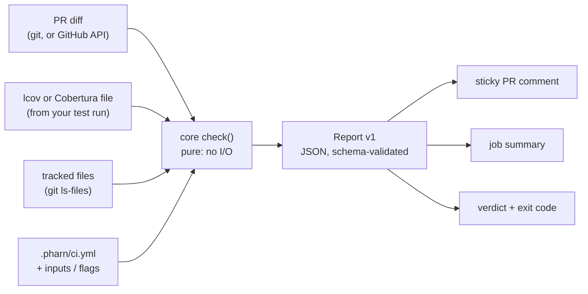

<div align="center">


# pharn-ci

**Know whether AI coding agents can safely work in your repo.**

A GitHub Action and CLI that checks every pull request for the two things an agent-written change
leans on most: tests that actually run the new code, and the setup files that tell agents how to
behave. AI-agnostic, fully stateless, no telemetry.

```yaml
- uses: pharn-dev/pharn-ci@v0.1.0
  with:
    coverage-file: coverage/lcov.info
    threshold: 80
```

[](https://github.com/pharn-dev/pharn-ci/actions/workflows/ci.yml)
[](https://github.com/pharn-dev/pharn-ci/actions/workflows/codeql.yml)
[](https://github.com/pharn-dev/pharn-ci/actions/workflows/gitleaks.yml)
[](./LICENSE)
[](./package.json)
[](https://pharn.dev)

</div>

> **Status:** pre-1.0 and not yet released. The first release will be `v0.1.0`; until it is cut,
> the snippet above will not resolve. Report v1 is stable; inputs and the comment layout may still
> change between minor versions.

---

## Contents

- [What pharn-ci is](#what-pharn-ci-is)
- [Why it exists](#why-it-exists)
- [Quick start](#quick-start)
- [How it works](#how-it-works)
- [Example PR comment](#example-pr-comment)
- [Action reference](#action-reference)
- [CLI](#cli)
- [Config](#config)
- [Report v1](#report-v1)
- [What it proves, and what it does not](#what-it-proves-and-what-it-does-not)
- [Safety model](#safety-model)
- [The Pharn family](#the-pharn-family)
- [Roadmap](#roadmap)
- [Development](#development)
- [Contributing and security](#contributing-and-security)
- [License](#license)

---

## What pharn-ci is

pharn-ci runs in your CI on every pull request and reports:

- **Diff coverage**: the share of lines **added** in the PR that your tests execute, with an
  optional threshold gate. It reads the lcov or Cobertura XML file your own test run already writes
  (Clover and JaCoCo native XML are not supported).
- **Agent setup inventory**: which agent setup files the repo carries (`CLAUDE.md`, `AGENTS.md`,
  `GEMINI.md`, `.claude/` files, Cursor, Copilot, Codex, Windsurf and Cline files, MCP configs; see
  the table below), with a summary of how many there are and which tools they configure.

| Kind                          | Matches                                                      | Tools                |
| ----------------------------- | ------------------------------------------------------------ | -------------------- |
| `claude-md`                   | `CLAUDE.md`, any directory                                   | claude-code          |
| `claude-local-md`             | `CLAUDE.local.md`, any directory                             | claude-code          |
| `agents-md`                   | `AGENTS.md`, any directory                                   | codex, copilot, cursor |
| `gemini-md`                   | `GEMINI.md`, any directory                                   | gemini               |
| `claude-settings`             | `.claude/settings.json`, any directory                       | claude-code          |
| `claude-settings-local`       | `.claude/settings.local.json`, any directory                 | claude-code          |
| `claude-skill`                | files under `.claude/skills/`, any directory                 | claude-code          |
| `claude-hook`                 | files under `.claude/hooks/`, any directory                  | claude-code          |
| `claude-agent`                | files under `.claude/agents/`, any directory                 | claude-code          |
| `claude-command`              | files under `.claude/commands/`, any directory               | claude-code          |
| `cursor-rules`                | files under `.cursor/rules/` (any directory), `.cursorrules` | cursor               |
| `cursor-mcp`                  | `.cursor/mcp.json`, repo root                                | cursor, mcp          |
| `copilot-instructions`        | `.github/copilot-instructions.md`                            | copilot              |
| `copilot-instructions-scoped` | `.github/instructions/**/*.instructions.md`                  | copilot              |
| `copilot-agents`              | files under `.github/agents/`                                | copilot              |
| `copilot-prompts`             | files under `.github/prompts/`                               | copilot              |
| `vscode-mcp`                  | `.vscode/mcp.json`, repo root                                | copilot, mcp         |
| `codex-config`                | `.codex/config.toml`, repo root                              | codex                |
| `windsurf-rules`              | `.windsurfrules`, files under `.windsurf/rules/`             | windsurf             |
| `cline-rules`                 | `.clinerules` (file or directory)                            | cline                |
| `mcp-config`                  | `.mcp.json`, any directory                                   | mcp                  |

It is **AI-agnostic**: it looks at your code, tests and setup files, never at which tool wrote the
code. Claude Code, Cursor, Copilot, Codex and hand-written changes are measured the same way.

The output is one sticky PR comment, the job summary, a pass/warn/fail verdict, and a JSON report
with a published schema that agents and scripts can read.

---

## Why it exists

Agents write diffs faster than people can review them. Review time does not scale with them, so
the cheap, mechanical questions should be answered before a person opens the PR:

- Did the tests run the code this change added, or only the code that was already there?
- Does the repo tell agents how to work in it at all, and where?
- Can a script or another agent read the answer without parsing prose?

pharn-ci answers those on every PR, with numbers and stable message codes rather than judgment. It
is a floor, not a verdict on quality: it says what was measured and, just as plainly, what was not
([What it proves](#what-it-proves-and-what-it-does-not)).

---

## Quick start

Add a workflow that runs your tests with lcov or Cobertura XML output, then pharn-ci:

```yaml
# .github/workflows/pharn-ci.yml
name: pharn-ci
on: pull_request

permissions:
  contents: read
  pull-requests: write

# One run per PR at a time, so concurrent pushes do not race on the sticky comment.
concurrency:
  group: pharn-ci-${{ github.event.pull_request.number }}
  cancel-in-progress: true

jobs:
  pharn-ci:
    runs-on: ubuntu-latest
    steps:
      - uses: actions/checkout@v7
        with:
          fetch-depth: 0
      # ...set up your toolchain and run tests with lcov or Cobertura output, e.g.:
      - run: npx vitest run --coverage --coverage.reporter=lcov
      - uses: pharn-dev/pharn-ci@v0.1.0 # or, better, the tag's full commit SHA
        with:
          coverage-file: coverage/lcov.info
          threshold: 80
```

`fetch-depth: 0` lets pharn-ci diff against the PR base locally. Without a threshold, pharn-ci
reports and never fails the step. The `concurrency` group cancels an older run when a new commit
is pushed; without it, two runs that each post the sticky comment are cleaned up to one, but the
older run may write last.

Release tags are exact versions (`v0.1.0`), never moved or deleted. Pinning the tag's full commit
SHA is stronger still; Dependabot keeps either up to date.

---

## How it works



| Step     | What happens                                                                                                                                 |
| -------- | -------------------------------------------------------------------------------------------------------------------------------------------- |
| Gather   | The Action or CLI reads the coverage file, the diff against the base, the tracked file list and the config. All I/O happens here.          |
| Measure  | `packages/core` matches added lines against the lines the coverage report knows, and classifies agent setup files. Pure functions only.     |
| Report   | Core builds a Report v1 object. Every report produced in tests is validated against `schema/report.v1.json`.                                |
| Render   | The comment, job summary and CLI text are renderings of that report, never a separate source of truth.                                     |

---

## Example PR comment

> ## ❌ pharn-ci: fail
>
> ### Diff coverage
>
> **71.43%** of changed lines covered (5/7, threshold 80%)
>
> | File | Coverage | Covered | Uncovered lines |
> | --- | ---: | ---: | --- |
> | `src/math.ts` | 75% | 3/4 | 10 |
> | `src/new.ts` | 50% | 1/2 | 5 |
> | `src/utils/new-name.ts` | 100% | 1/1 |  |
>
> ### Agent setup
>
> Agent setup: 3 files · claude-code, codex, copilot, cursor
>
> | Path | Kind |
> | --- | --- |
> | `.claude/settings.json` | claude-settings |
> | `AGENTS.md` | agents-md |
> | `CLAUDE.md` | claude-md |
>
> ### Messages
>
> - ❌ `DIFF_COVERAGE_BELOW_THRESHOLD` Diff coverage 71.43% is below the threshold of 80%.

On PRs from forks the token cannot comment; pharn-ci then warns and uses the job summary only.

---

## Action reference

| Input               | Default                     |                                          |
| ------------------- | --------------------------- | ---------------------------------------- |
| `coverage-file`     | `coverage.file` from config | Path to the coverage report              |
| `coverage-format`   | `coverage.format`, then `auto` | `lcov`, `cobertura` or `auto` (detect it from the start of the file) |
| `threshold`         | none                        | Minimum diff coverage %, inclusive       |
| `base-ref`          | PR base                     | Ref or SHA to diff against               |
| `exclude`           | none                        | Globs of changed files to leave out of diff coverage, comma or newline separated; added to `coverage.exclude` |
| `require-agent-setup` | `setup.require`, then `false` | Fail when the repo has no agent setup files; the step fails through `fail-on-threshold` |
| `comment`           | `true`                      | Post/update one sticky PR comment        |
| `fail-on-threshold` | `true`                      | Fail the step when the verdict is `fail` |
| `config`            | `.pharn/ci.yml`             | Config file path                         |
| `github-token`      | `github.token`              | Token for the comment and diff fallback  |

| Output          |                                                       |
| --------------- | ----------------------------------------------------- |
| `report-path`   | Path to `report.json` (Report v1)                     |
| `verdict`       | `pass`, `warn` or `fail`                              |
| `diff-coverage` | Diff coverage percent, or empty when not computed     |

---

## CLI

```bash
pnpm install && pnpm build
node packages/cli/dist/index.js check --coverage coverage/lcov.info --threshold 80
```

```text
pharn-ci check [--coverage <file>] [--coverage-format lcov|cobertura|auto] [--base <ref>]
               [--threshold <n>] [--format md|json] [--config <path>] [--exclude <glob>]...
               [--require-agent-setup] [-h|--help] [-v|--version]
```

- `--coverage-format` defaults to `coverage.format` from the config, then `auto`, which reads lcov
  or Cobertura XML from the start of the file. The chosen format is printed on stderr, for example
  `coverage: cobertura (auto-detected)`.
- `--base` defaults to `origin/main`; the diff is `git diff --unified=0 <base>...HEAD`.
- `--exclude <glob>` leaves matching changed files out of diff coverage. Repeat it for several
  patterns; they are added to `coverage.exclude`, never replacing it
  ([Excluding files](#excluding-files)).
- `--require-agent-setup` fails the check (exit `1`) when the repo has no agent setup files. Absent,
  `setup.require` from the config decides, then off. The flag cannot turn off a requirement the
  config turns on.
- `--format json` prints only the report to stdout, for agents and scripts.
- Exit codes: `0` pass or warn, `1` fail, `2` usage or runtime error.

The CLI is not published to npm yet; build it from source.

---

## Config

`.pharn/ci.yml` (CLI flags and Action inputs override it):

```yaml
coverage:
  file: coverage/lcov.info
  format: auto # lcov, cobertura or auto (the default)
  threshold: 80
  exclude:
    - src/generated/**
    - "*.gen.ts"
setup:
  require: false # true fails the check when the repo has no agent setup files
```

### Excluding files

Generated code, vendored files and the like can be left out of diff coverage with glob patterns.
Patterns come from three sources that are **merged** (a union, never an override):
`coverage.exclude` in `.pharn/ci.yml`, the CLI's `--exclude` flags and the Action's `exclude` input.

- The glob subset is `*` (any run of characters within one path segment), `**` as a whole segment
  (any number of segments, including none) and `?` (one character). Patterns are anchored at the
  repository root, must match the whole path, and are case-sensitive. Braces, `[...]` classes,
  negation (`!`) and backslashes are rejected with an error rather than guessed at.
- A pattern that starts with `*` must be quoted in YAML (`"*.gen.ts"`).
- Only changed files are affected. Excluded files count nowhere in diff coverage; they are listed
  under `diffCoverage.excludedFiles` in the report and in an "Excluded" summary in the comment.
- The agent setup inventory is not affected by exclusions.
- Exclusions come from the PR itself, so a PR can exclude its own files. Protect `.pharn/ci.yml` (and
  your workflow file) with CODEOWNERS.

---

## Report v1

The JSON report is the stable, machine-readable API; the comment and CLI text are renderings of
it. See [`schema/report.v1.json`](schema/report.v1.json). Branch on message `code`s, not on text:

| Code                            | Meaning                                                        |
| ------------------------------- | -------------------------------------------------------------- |
| `DIFF_COVERAGE_BELOW_THRESHOLD` | Diff coverage is below the configured threshold                |
| `NO_COVERABLE_CHANGES`          | None of the added lines are tracked by the coverage report     |
| `COVERAGE_FILE_MISSING`         | The coverage file does not exist                               |
| `COVERAGE_FILE_EMPTY`           | The coverage file has no usable records                        |
| `COVERAGE_FORMAT_UNSUPPORTED`   | The coverage file is not lcov or Cobertura XML (format `auto`) |
| `DIFF_UNAVAILABLE`              | No diff could be produced, so diff coverage was not computed   |
| `NO_AGENT_SETUP_FILES`          | The repo has none of the agent setup files pharn-ci looks for  |

Within v1, fields are only added and codes are never renamed or removed.

---

## What it proves, and what it does not

**Measured:** which added lines the coverage report marks as executed, compared against an
inclusive threshold after rounding to two decimals; which known agent setup files are tracked in
git.

**Not measured**, stated plainly (full list in [`docs/LIMITS.md`](docs/LIMITS.md)):

- **Coverage is not test quality.** A covered line was executed; nothing says a test asserted
  anything about it.
- **Only added lines count.** A change that deletes the tests for code it leaves in place does not
  lower diff coverage.
- **Files missing from the coverage report are invisible.** Configure your coverage tool to include
  all source files if untested files should count.
- **The inventory is not a review.** pharn-ci lists agent setup files and never reads them. It is
  informational (`NO_AGENT_SETUP_FILES` is `info`) unless `require-agent-setup` or `setup.require`
  is on, which makes it an `error` and the verdict `fail`.
- **The setup requirement comes from the PR.** The `.pharn/ci.yml` a PR carries can switch
  `setup.require` off, so protect it with CODEOWNERS (or set the Action input in the workflow).
- **pharn-ci trusts the coverage file.** The PR's own tests write it in the same job; a PR that
  alters its test setup can produce a favorable one.
- **Exclusions come from the PR.** The config and workflow a PR carries decide which of its files
  are left out of the measurement ([Excluding files](#excluding-files)).

---

## Safety model

pharn-ci runs inside other people's CI, on untrusted changes, with their token. It is built for
that:

- **Stateless.** No backend, no telemetry, no network calls except the GitHub API inside the
  Action.
- **Small token footprint.** `contents: read` plus `pull-requests: write`. It reads the compare API
  and comments, and updates only a comment its own login wrote. It deletes a comment only when
  concurrent runs left duplicates of that own marker comment.
- **Untrusted input stays data.** Parsers are hand-written, pure and non-recursive. File names and
  message text cannot inject markdown or HTML into the PR comment. Git runs without a shell, and
  refs starting with `-` are rejected.
- **Pure core.** `packages/core` cannot do I/O; a test, a lint rule and its tsconfig enforce it.
- **Reviewable releases.** The committed Action bundle is rebuilt and diffed in CI. Third-party
  actions are pinned to commit SHAs, two runtime dependencies, CodeQL, gitleaks and Socket checks
  on every PR, and release tags are never moved.

Each claim is mapped to the test or check that enforces it in
[`docs/THREAT-MODEL.md`](docs/THREAT-MODEL.md). Do not run pharn-ci on `pull_request_target` with
an untrusted checkout ([`SECURITY.md`](SECURITY.md)).

---

## The Pharn family

| Project                                                 | What it does                                                                         |
| ------------------------------------------------------- | ------------------------------------------------------------------------------------ |
| [pharn-oss](https://github.com/pharn-dev/pharn-oss)     | The PHARN workflow for Claude Code: spec, plan, test-first, build, verify, in Git.   |
| [pharn-cli](https://github.com/pharn-dev/pharn-cli)     | `npx @pharn-dev/pharn init`: installs and updates PHARN in your project.            |
| **pharn-ci**                                            | The CI check: diff coverage and agent setup on every PR, whatever wrote the code.   |

pharn-ci does not need PHARN installed and does not read its artifacts. It is useful on its own in
any repo with an lcov- or Cobertura-producing test run.

**pharn-ci checks pharn-ci.** This repository's own `ci` job runs the Action from source on every
PR with an 80% diff-coverage threshold, so every change here passes the same gate it ships.

---

## Roadmap

- More coverage formats (Clover, JaCoCo native XML)
- Flaky test detection
- Test-tampering detection (weakened, skipped or deleted tests)
- Agent policy checks on top of the setup inventory

---

## Development

```bash
pnpm install          # install
pnpm build            # typecheck + build core, bundle cli and action
pnpm test             # vitest (all packages)
pnpm test:coverage    # vitest with lcov output in coverage/
pnpm lint             # biome check + typecheck
pnpm pharn-ci check   # run the built CLI on this repo
```

| Package           | Role                                                                                   |
| ----------------- | -------------------------------------------------------------------------------------- |
| `packages/core`   | Pure functions: lcov, Cobertura and diff parsing, diff coverage, setup scan, Report v1. |
| `packages/cli`    | `pharn-ci check`: reads files, runs git, calls core, prints output.                    |
| `packages/action` | Thin Action wrapper: inputs, PR diff, sticky comment, job summary, exit code.          |

The rules every change follows are in [`AGENTS.md`](AGENTS.md).

---

## Contributing and security

- [`CONTRIBUTING.md`](CONTRIBUTING.md): setup, what CI checks, and how to propose a change.
- [`SECURITY.md`](SECURITY.md): report vulnerabilities privately, not in public issues.
- [`CHANGELOG.md`](CHANGELOG.md) and [`docs/RELEASING.md`](docs/RELEASING.md).
- This project follows the [Code of Conduct](CODE_OF_CONDUCT.md).

## License

[Apache-2.0](LICENSE)
