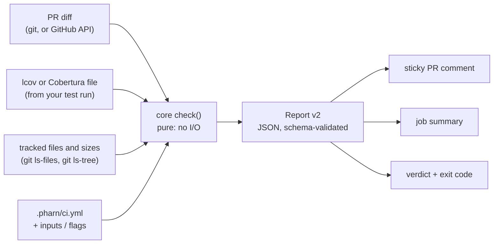

# How pharn-ci works

## What pharn-ci is

pharn-ci runs in your CI on every pull request and reports:

- **Diff coverage**: the share of lines **added** in the PR that your tests execute, with an
  optional threshold gate. It reads the lcov or Cobertura XML file your own test run already writes
  (Clover and JaCoCo native XML are not supported).
- **Agent setup inventory**: which agent setup files the repo carries (`CLAUDE.md`, `AGENTS.md`,
  `GEMINI.md`, `.claude/` files, MCP configs, and the files of Cursor, Copilot, Codex, Windsurf,
  Cline, Aider, Continue, Roo Code, Amazon Q Developer, Junie, Zed, Augment, Kiro, Goose, OpenCode
  and Gemini CLI; see the table below), with a summary of how many there are and which tools they
  configure.

| Kind                          | Matches                                                                                        | Tools                                             |
| ----------------------------- | ---------------------------------------------------------------------------------------------- | ------------------------------------------------- |
| `claude-md`                   | `CLAUDE.md`, any directory                                                                     | claude-code                                       |
| `claude-local-md`             | `CLAUDE.local.md`, any directory                                                               | claude-code                                       |
| `agents-md`                   | `AGENTS.md`, any directory                                                                     | amp, codex, copilot, cursor, jules, opencode, zed |
| `gemini-md`                   | `GEMINI.md`, any directory                                                                     | gemini                                            |
| `claude-settings`             | `.claude/settings.json`, repo root                                                             | claude-code                                       |
| `claude-settings-local`       | `.claude/settings.local.json`, repo root                                                       | claude-code                                       |
| `claude-skill`                | files under `.claude/skills/`, any directory                                                   | claude-code                                       |
| `claude-hook`                 | files under `.claude/hooks/`, any directory                                                    | claude-code                                       |
| `claude-agent`                | files under `.claude/agents/`, any directory                                                   | claude-code                                       |
| `claude-command`              | files under `.claude/commands/`, any directory                                                 | claude-code                                       |
| `claude-rule`                 | files under `.claude/rules/`, any directory                                                    | claude-code                                       |
| `cursor-rules`                | files under `.cursor/rules/` (any directory), `.cursorrules`                                   | cursor                                            |
| `cursor-mcp`                  | `.cursor/mcp.json`, repo root                                                                  | cursor, mcp                                       |
| `copilot-instructions`        | `.github/copilot-instructions.md`                                                              | copilot                                           |
| `copilot-instructions-scoped` | `.github/instructions/**/*.instructions.md`                                                    | copilot                                           |
| `copilot-agents`              | files under `.github/agents/`                                                                  | copilot                                           |
| `copilot-prompts`             | files under `.github/prompts/`                                                                 | copilot                                           |
| `vscode-mcp`                  | `.vscode/mcp.json`, repo root                                                                  | copilot, mcp                                      |
| `codex-config`                | `.codex/config.toml`, repo root                                                                | codex                                             |
| `windsurf-rules`              | `.windsurfrules`, files under `.windsurf/rules/`                                               | windsurf                                          |
| `cline-rules`                 | `.clinerules` (file or directory)                                                              | cline                                             |
| `mcp-config`                  | `.mcp.json`, repo root                                                                         | mcp                                               |
| `aider-config`                | `.aider.conf.yml`, repo root                                                                   | aider                                             |
| `conventions-md`              | `CONVENTIONS.md`, repo root                                                                    | aider                                             |
| `continue-rules`              | files under `.continue/rules/`, `.continuerules`, repo root                                    | continue                                          |
| `roo-rules`                   | `.roorules`, `.roorules-<mode>`, files under `.roo/rules/` and `.roo/rules-<mode>/`, repo root | roo                                               |
| `amazonq-rules`               | files under `.amazonq/rules/`, repo root                                                       | amazon-q                                          |
| `junie-guidelines`            | `.junie/guidelines.md`, repo root                                                              | junie                                             |
| `zed-rules`                   | `.rules`, repo root                                                                            | zed                                               |
| `augment-rules`               | files under `.augment/rules/`, `.augment-guidelines`, repo root                                | augment                                           |
| `kiro-steering`               | files under `.kiro/steering/`, repo root                                                       | kiro                                              |
| `goosehints`                  | `.goosehints`, any directory                                                                   | goose                                             |
| `opencode-config`             | `opencode.json`, `opencode.jsonc`, repo root                                                   | opencode                                          |
| `gemini-settings`             | `.gemini/settings.json`, repo root                                                             | gemini                                            |

Placeholders do not count: a dot-file (such as `.gitkeep`) or a README under a directory in the table
is not listed, and neither is any path with a `node_modules` directory. A listed file that is empty in
`HEAD` gets an `AGENT_SETUP_FILE_EMPTY` warning, and stays in the inventory.

It is **AI-agnostic**: it measures your code, tests and setup files, never which tool wrote the code.
Claude Code, Cursor, Copilot, Codex and hand-written changes are measured the same way. The one exception is opt-in:
under an org policy, rules P11 (protected paths), P13 (agent self-modification) and P14 (size caps) apply only to pull
requests it detects as agent-written (see [Agent PRs](output.md#agent-prs)).

The output is one sticky PR comment, the job summary, a pass/warn/fail verdict, and a JSON report
with a published schema that agents and scripts can read.

## Why it exists

Agents write diffs faster than people can review them. Review time does not scale with them, so
the cheap, mechanical questions should be answered before a person opens the PR:

- Did the tests run the code this change added, or only the code that was already there?
- Does the repo tell agents how to work in it at all, and where?
- Can a script or another agent read the answer without parsing prose?

pharn-ci answers those on every PR, with numbers and stable message codes rather than judgment. It
is a floor, not a verdict on quality: it says what was measured and, just as plainly, what was not
([What it proves](what-it-proves.md)).

## How it works

| Step     | What happens                                                                                                                                 |
| -------- | -------------------------------------------------------------------------------------------------------------------------------------------- |
| Gather   | The Action or CLI reads the coverage file, the diff against the base, the tracked file list and the config. All I/O happens here.          |
| Measure  | `packages/core` matches added lines against the lines the coverage report knows, and classifies agent setup files. Pure functions only.     |
| Report   | Core builds a Report v2 object. Every report produced in tests is validated against `schema/report.v2.json`.                                |
| Render   | The comment, job summary and CLI text are renderings of that report, never a separate source of truth.                                     |

## Example PR comment

> 
>
> ## 🛡️ pharn-ci · ❌ Fail
>
> > [!CAUTION]
> > **Fail** · Diff coverage of this change is 71.43% against a threshold of 80%; 8 agent setup files found.
>
> | Verdict | Diff coverage | Test integrity | Agent setup |
> | --- | --- | --- | --- |
> | ❌ Fail | 71.43% (threshold 80%) | none (warn) | 8 files |
>
> ### 🧪 Diff coverage
>
> `▰▰▰▰▰▰▰▰▰▰▰▰▰▰▱▱▱▱▱▱` 71.43%
>
> **71.43%** of changed lines covered (5/7, threshold 80%)
>
> 

> 
Changed files (3)

>
> | File | Coverage | Covered | Uncovered lines |
> | --- | ---: | ---: | --- |
> | `src/new.ts` | 50% | 1/2 | 5 |
> | `src/math.ts` | 75% | 3/4 | 10 |
> | `src/utils/new-name.ts` | 100% | 1/1 |  |
>
> 

>
> ### 🔍 Test integrity
>
> No test-integrity findings (mode: warn).
>
> ### 💬 Messages (2)
>
> - ❌ `DIFF_COVERAGE_BELOW_THRESHOLD` Diff coverage 71.43% is below the threshold of 80%.
>   - Hint: Add tests that exercise the uncovered lines listed in the table above.
> - ℹ️ `COVERAGE_PATHS_PARTIALLY_UNMATCHED` 1 file path in the coverage report is not a tracked file in the repository; its coverage is not used.
>   - Hint: Nothing to do if those files are generated or outside the repo; if changed files are missing from the table, check the coverage root.
>
> ### 🤖 Agent setup (8 files)
>
> Agent setup: 8 files · amp, claude-code, codex, copilot, cursor, jules, mcp, opencode, zed
>
> 

> 
Agent setup files (8)

>
> | Path | Kind |
> | --- | --- |
> | `.claude/settings.json` | claude-settings |
> | `.claude/skills/release/SKILL.md` | claude-skill |
> | `.cursor/rules/style.mdc` | cursor-rules |
> | `.github/copilot-instructions.md` | copilot-instructions |
> | `.mcp.json` | mcp-config |
> | `AGENTS.md` | agents-md |
> | `CLAUDE.md` | claude-md |
> | `packages/web/CLAUDE.md` | claude-md |
>
> 

>
> ---
>
> pharn-ci 0.11.0 · report schema v2 · coverage format lcov

On PRs from forks the token cannot comment; pharn-ci then warns and uses the job summary only.

Each workflow and job keeps its own comment, marked by a hidden `<!-- pharn-ci scope: <workflow>/<job> -->`
line. Matrix legs of one job share that scope, and so one comment: the leg that finishes last replaces the other
legs' findings in it. Each leg's job summary and `report.json` keep its own.
